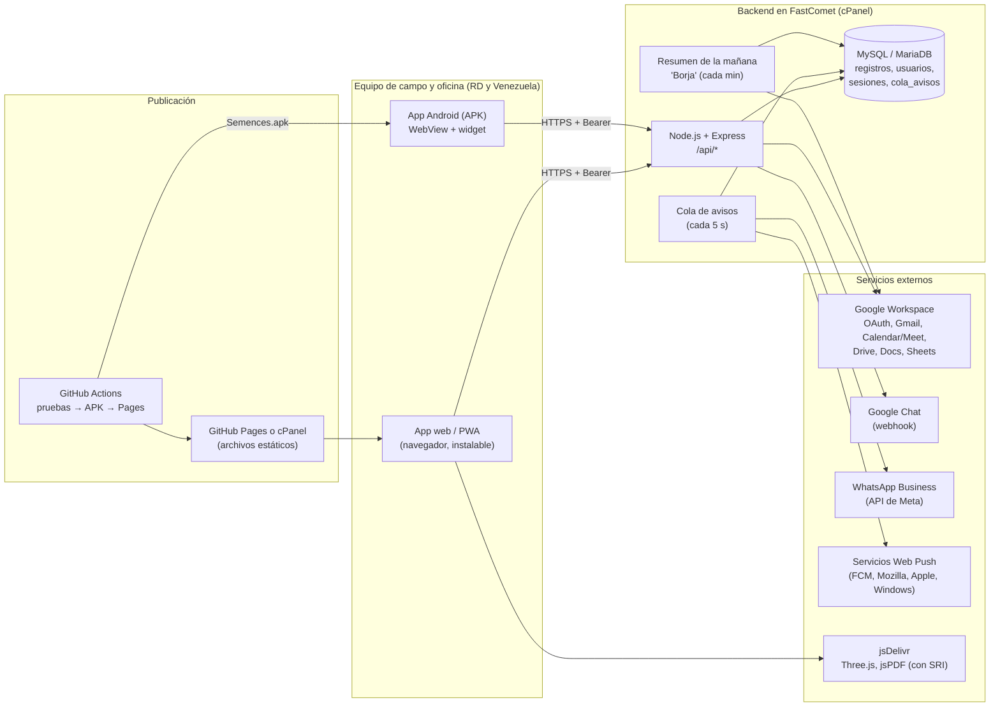
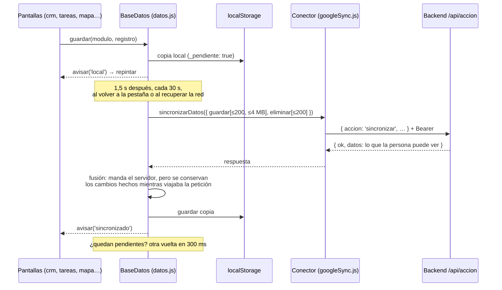
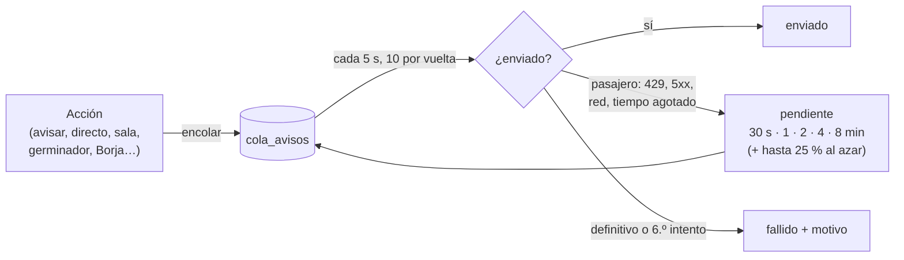

# Semences del Caribe · CRM: documentación completa de la arquitectura

> **Qué es:** el CRM interno de Semences del Caribe, importadora y distribuidora de semillas de hortalizas
> (representante de **Fitó** y **Gautier Semences**, además de Hexagon Seeds y Genome Seeds) con operación en
> **República Dominicana** y **Venezuela**. Reúne clientes, visitas de campo, procesos agronómicos, rendimientos,
> el germinador (lotes en cámara), tareas, chat del equipo, cotizaciones en PDF y una finca de ensayo en 3D.
>
> **Para quién es este documento:** quien tenga que mantener, desplegar o auditar la app. Explica cómo encajan
> las piezas, por dónde viajan los datos, quién puede ver qué y cómo se prueba y se publica. Al final están los
> resultados de la auditoría de noviembre de 2026 y las recomendaciones pendientes.
>
> Guías paso a paso que ya existían (y que este documento no repite): `servidor/LEEME.md` (backend y FastComet),
> `android/LEEME.md` (APK) y `apps-script/DESPLIEGUE.md` (modo Apps Script y publicación).

---

## Índice

1. [Vista general](#1-vista-general)
2. [Mapa del repositorio](#2-mapa-del-repositorio)
3. [Modos de funcionamiento](#3-modos-de-funcionamiento)
4. [La app web (PWA)](#4-la-app-web-pwa)
5. [La app Android (APK)](#5-la-app-android-apk)
6. [El backend (Node.js + MySQL)](#6-el-backend-nodejs--mysql)
7. [Modelo de seguridad](#7-modelo-de-seguridad)
8. [Avisos: Google Chat, WhatsApp y push](#8-avisos-google-chat-whatsapp-y-push)
9. [El modo Apps Script (heredado)](#9-el-modo-apps-script-heredado)
10. [Publicación: GitHub Actions, Pages y cPanel](#10-publicación-github-actions-pages-y-cpanel)
11. [Pruebas automáticas](#11-pruebas-automáticas)
12. [Auditoría de noviembre de 2026](#12-auditoría-de-noviembre-de-2026)
13. [Recomendaciones pendientes](#13-recomendaciones-pendientes)
14. [Tareas habituales de mantenimiento](#14-tareas-habituales-de-mantenimiento)

---

## 1. Vista general



| Pieza | Tecnología | Dónde vive |
|---|---|---|
| App web | HTML + CSS + JavaScript sin compilar (scripts clásicos, sin framework). Three.js r128 para la finca 3D, jsPDF 4.2.1 para cotizaciones | GitHub Pages o el `public_html` de cPanel |
| App Android | Un `WebView` (Java, sin Gradle) que sirve la misma app web desde el APK, más un widget de pantalla de inicio | APK firmado, descargable desde la web |
| Backend | Node.js ≥ 20.12 (probado en 22 y 24), Express 5, `mysql2`, librerías oficiales de Google, `web-push` | FastComet: cPanel › Setup Node.js App (Passenger) |
| Base de datos | MySQL 8.4 o MariaDB 10.11 | El MySQL de cPanel |
| Integraciones | Google Workspace (a nombre de cada persona), Google Chat, WhatsApp Cloud API, Web Push (VAPID) | Servicios de terceros |
| CI/CD | GitHub Actions: pruebas (Node 22 y 24, MySQL y MariaDB) → APK firmado → GitHub Pages | `.github/workflows/publicar.yml` |

---

## 2. Mapa del repositorio

```
semences-crm/
├── index.html              Página única: carga estilos, librerías (CDN con SRI) y los scripts en orden
├── style.css               Todo el diseño (tokens --sdc-*, tema claro/oscuro, vista de tarjetas en móvil)
├── manifest.webmanifest    PWA instalable (iconos, colores, pantalla completa)
├── sw.js                   Service worker: sin conexión + avisos push con la app cerrada
├── tema.js                 Tema claro/oscuro antes de pintar (en <head>, sin parpadeo)
├── googleSync.js           Conector: backend Node (api) o Apps Script (url + token)
├── app.js                  Simulador 3D de la finca (Three.js), métricas y panel de parcelas
├── datos.js                Base de datos de la app: copia local (localStorage) + sincronización
├── usuario.js              Quién usa la app: entrar con Google, sala de espera, cuenta, sesión
├── mapa.js                 Fichas editables de edificios y parcelas del 3D (lista de precios, notas)
├── cotizador.js            Cotización desde la lista de precios de la oficina → PDF o correo
├── crm.js                  Módulos del CRM: clientes, visitas, procesos, rendimiento, germinador, pedidos
├── equipo.js               Chat del equipo y "Notificar al equipo" (alertas)
├── tareas.js               Tareas del equipo
├── tablero.js              Tablero del equipo (presencia, directos, Meet) y accesos (Master)
├── accesos.js              Barra de accesos (cabecera y barra inferior del móvil), campana y mensajes 1 a 1
├── agenda.js               Agenda de la semana: datos de la app + Google Calendar
├── reunionesMetas.js       Reuniones (programar con Meet, acta → tareas) y metas mensuales
├── pwa.js                  Instalar la app y compartirla
├── ventana.js              Finca 3D en ventana flotante (Picture-in-Picture de documentos)
├── iconos/, marcas/        Iconos de la PWA y logos de las casas comerciales
├── publicar.sh             Prepara publicar/ (web lista para subir) y su .htaccess
├── pruebas-web/            Pruebas unitarias de la app web (node --test, sin dependencias)
├── android/                APK: MainActivity.java, widget, build.sh, librerías locales (lib/)
├── apps-script/            Modo heredado: Code.gs (Google Sheets como base) y su guía
├── servidor/               Backend Node + MySQL
│   ├── app.js              Arranque: config → MySQL → Express → cola → resúmenes
│   ├── src/                Módulos (ver sección 6)
│   ├── pruebas/            api.test.js (contra la base), unidad.test.js y modulos.test.js
│   └── herramientas/       npm run clave | vapid | equipo
└── .github/workflows/publicar.yml
```

---

## 3. Modos de funcionamiento

La misma app web funciona de tres maneras, según lo que `googleSync.js` reciba al publicar (lo pone GitHub Actions
desde los secretos del repositorio; el repositorio es público y no guarda direcciones ni claves):

| Modo | Se activa con | Base de datos | Inicio de sesión | Estado |
|---|---|---|---|---|
| **Backend** (recomendado) | `CONFIG_GOOGLE.api` ← secreto `SEMENCES_API` | MySQL en el servidor, filtrada por cargo, país y casa | Google OAuth con código + sesión del backend (30 días) | Actual |
| **Apps Script** | `url` + `token` ← `SEMENCES_URL` y `SEMENCES_TOKEN` | Hoja de Google Sheets (una pestaña por módulo) | Opcional: Google One Tap (`clientId`) | Heredado (ver 9 y 13) |
| **Solo local** | nada | `localStorage` del navegador | Un nombre escrito a mano | Demostración |

Si hay `api`, manda el backend y se ignoran `url` y `token`.

---

## 4. La app web (PWA)

### 4.1 Carga

`index.html` carga, en este orden: `tema.js` (en `<head>`), las librerías del CDN y después, al final del `<body>`,
`googleSync.js → app.js → datos.js → usuario.js → mapa.js → cotizador.js → crm.js → equipo.js → tareas.js →
tablero.js → bandejaInstagram.js → panel.js → reporte.js → accesos.js → agenda.js → reunionesMetas.js → pwa.js →
ventana.js`. Son scripts clásicos que comparten el ámbito global (`window.baseDatos`,
`window.responsable`, `window.cotizador`, `window.appDashboard`, `window.equipo`…). Los módulos que dependen del
3D se crean en el evento `load`.

Las tres librerías vienen de **jsDelivr con versión fija y huella SRI** (`integrity`): el navegador comprueba el
archivo y no lo ejecuta si alguien lo cambiara en el CDN. Es importante porque la sesión del CRM vive en el
navegador: un script alterado podría leerla.

### 4.2 Datos y sincronización (`datos.js`)



- **Sin conexión** se trabaja igual: todo queda en `localStorage` con la marca `_pendiente` y sube al volver la red.
- **Tandas:** si hay muchos cambios pendientes (días sin señal en el campo), salen de 200 en 200 y como mucho
  ~4 MB por petición. *Antes de la auditoría se mandaban todos juntos y, pasados los límites del servidor (500
  cambios o 10 MB), la sincronización fallaba siempre.*
- **Permisos:** si el servidor rechaza un cambio por permisos (código `permiso`), la app descarta los cambios
  pendientes, avisa y vuelve a pedir los datos: no reintenta para siempre algo que nunca se aceptará.
- **Cerrar sesión** (`olvidarTodo`) borra la copia local: lo que vio una cuenta no queda para la siguiente.

### 4.3 Módulos del CRM (`crm.js`)

| Módulo | Qué guarda | Campos con ámbito |
|---|---|---|
| `clientes` | Nombre, teléfono, WhatsApp, correo, ubicación, marca, próximo seguimiento, próxima reunión (Meet), asignado a | país + casa |
| `visitas` | Fecha, cliente, ubicación, estado del cultivo, comentarios | país + casa |
| `agronomia` | Cliente, lote, variedad, fase, inicio, fin, % germinación | país + casa |
| `rendimiento` | Cliente, lote, fecha, rendimiento por planta, canastos, unidades | país + casa |
| `germinador` | Lote, variedad, estado, siembra, trasplante, bandejas, semillas (miles), % germinación, temperatura, humedad | país + casa |
| `tareas`, `mensajes`, `sitios` | Tareas, chat/alertas del equipo y fichas del mapa 3D | de todo el equipo |

Cada registro es un objeto JSON con `id`; el servidor le añade `cuenta` (la cuenta verificada que lo subió).
Desde la ficha de un cliente: expediente, correo (Gmail), reunión con Meet (comprueba antes si la hora está
ocupada), reporte PDF en Drive (carpeta propia del cliente) y enlaces `tel:`, `mailto:` y WhatsApp
(`wa.me/…`, con números de **RD y de Venezuela** pasados a formato internacional).

### 4.4 Cotizador (`cotizador.js`)

La lista de precios es el texto de la ficha de las oficinas en el mapa 3D, una línea por producto:

```
- Semilla de tomate saladette F1: US$45,50 / sobre
- Semilla de pimiento Fitó: RD$1,250.00 / sobre
- Asesoría técnica: incluida            ← sin precio: no se cotiza
```

- Monedas: `$`, `US$`, `RD$`. Los totales van **por moneda** (RD$ y US$ no se suman entre sí).
- Importes como en RD (`1,250.50`) o como en Venezuela (`1.250,50`, `45,50`). Con un solo separador seguido de
  3 cifras (`1,500`) se lee como miles; `1.500` se lee como 1,5 (como siempre). Para evitar dudas, escribe los
  céntimos (`1.500,00` o `1,500.00`).
- Sale un PDF (jsPDF) con número `COT-AAAAMMDD-HHMM`, que se descarga (en el APK, a *Descargas*) o se envía por
  correo desde el Gmail de quien cotiza, con aviso por WhatsApp al cliente si está configurado.

### 4.5 Inicio de sesión (`usuario.js`), en modo backend

1. La app genera un **verificador** aleatorio (lo guarda en `localStorage`) y manda su SHA-256 (**reto**) a
   `GET /api/auth/google/inicio?reto=…&vuelta=…`.
2. El backend firma un `state` (HMAC, 10 minutos) y redirige a Google.
3. Google vuelve a `/api/auth/google/vuelta`. El backend comprueba la cuenta y crea un **código de un solo uso**
   (2 minutos) atado al reto. Vuelve a la web (`…#google-codigo=…`) o a la app Android (`semences://sesion?codigo=…`).
4. La app canjea `{ codigo, verificador }` en `POST /api/auth/canjear` y recibe la **sesión**, que manda en cada
   petición como `Authorization: Bearer …`.

Si la cuenta es nueva, entra en la **sala de espera**: deja su WhatsApp y espera a que un Master la apruebe.

### 4.6 Service worker (`sw.js`)

| Qué | Estrategia |
|---|---|
| Archivos de la app (mismo origen) | Red primero (llegan las actualizaciones); sin red, la copia guardada |
| Librerías y fuentes (jsDelivr, Google Fonts) | Copia guardada primero (URLs con versión fija). Solo se guardan respuestas correctas |
| Backend, Google, Meta | No pasan por el service worker |
| Avisos push | Muestra la notificación y, al tocarla, abre o enfoca la app |

Al publicar cambios grandes hay que subir `VERSION` (ahora `semences-v10`) para descartar las copias viejas.

### 4.7 Otros módulos de la pantalla

- **`app.js`:** la finca 3D (invernaderos y campo abierto, clima, tractores), métricas (semillas distribuidas,
  parcelas activas, eficiencia) y el panel de parcelas. Envía métricas al servidor (`sheets`).
- **`mapa.js`:** al tocar un edificio o parcela se abre su ficha editable (compartida por todo el equipo).
- **`equipo.js` / `tareas.js` / `tablero.js`:** chat, alertas, tareas, presencia (latido cada minuto), mensajes
  directos, videollamadas, pasar clientes y, para los Master, *Equipo y accesos*.
- **`pwa.js`, `ventana.js`, `tema.js`:** instalar y compartir la app, ventana flotante en el ordenador y tema.
- **`bandejaInstagram.js` / `panel.js` / `reporte.js`:** bandeja de Instagram (administración), panel de
  indicadores por cargo y reporte semanal de actividades.
- **`accesos.js` / `agenda.js` / `reunionesMetas.js`:** los botones de Agenda, Mensajes, Avisos, Equipo, Reuniones,
  Metas, Tareas y Chat, en la cabecera (solo iconos en pantallas medianas) y, en el móvil, en una barra inferior con
  Agenda, Mensajes, Avisos, Tareas y "Más". Solo hay un panel lateral abierto a la vez (`cerrarPanelesLaterales`).
  La **campana** reúne los avisos de cada persona (mensajes, clientes, tareas, reuniones, germinador, envíos,
  Instagram, reportes y metas) y cada uno lleva a su sitio. **Mensajes**: el chat general y conversaciones 1 a 1.
  **Agenda**: la semana con seguimientos, reuniones, tareas, llegadas de envíos y trasplantes, más los eventos de
  Google Calendar. **Reuniones**: se programan con Meet e invitación; el acta convierte cada acuerdo con
  responsable en una tarea suya. **Metas**: las fijan Master y administración; el avance se calcula solo.
  Sin backend quedan la Agenda (con los datos del dispositivo), Tareas y Chat.

### 4.8 Sistema de diseño (`style.css`)

Todo el aspecto sale de **tokens** (variables CSS) definidos al principio de `style.css`. En las reglas no se
escriben colores, pesos, capas ni radios a mano: se usa el token (`var(--…)`). Una prueba (`pruebas-web`)
comprueba además que la hoja tenga las llaves equilibradas.

| Familia | Tokens | Para qué |
|---|---|---|
| Marca (`--sdc-*`) | `fondo`, `tarjeta`, `primario`, `brote`, `menta`, `dorado`, `peligro`, `agua`… | Colores fijos de la marca; los lee también la escena 3D (`app.js`) |
| Tema (`--ui-*`) | `fondo`, `tarjeta`, `apagado`, `borde`, `texto`, `texto-suave`, `titulo`, `enlace`, `error`, `aviso`, `foco`, `grafico`, `aviso-grafico` | Cambian entre oscuro y claro (tres bloques: oscuro por defecto, `prefers-color-scheme: light` y `data-tema="claro"`). **Un color nuevo de la interfaz va aquí, con su valor en los tres bloques** |
| Gráficos | `--ui-grafico` (barras, azul) y `--ui-aviso-grafico` (bajo el mínimo, ámbar) | Comprobados para daltonismo. `--ui-aviso` es para texto y bordes; `--ui-aviso-grafico`, para rellenos. Un aviso nunca va solo con color: lleva ⚠️ y texto |
| Tipografía | `--font-titulo` (Lora), `--font-cuerpo` (Raleway), `--font-dato` (JetBrains Mono); tamaños `--sdc-texto-xs…xl` y `--sdc-texto-cifra`; pesos `--sdc-peso-normal/medio/fuerte/extra` (400/600/700/800) | Mínimo 0,7 rem; los campos de formulario, 1 rem (evita el zoom del móvil) |
| Espaciado | `--sdc-espacio-1…6` (4, 6, 8, 12, 16, 20 px) | Márgenes, rellenos y huecos. Solo los ajustes de 1–2 px van a mano |
| Bordes y sombras | `--sdc-radio-barra/xs/sm/md/pildora` (4, 6, 10, 16, 999 px), `--sdc-sombra`, `--sdc-sombra-acento` | Los avatares usan `50%` |
| Estados | `--sdc-transicion`, `--sdc-opacidad-apagado`, `--sdc-objetivo-tactil` (44 px) | Lo que se pulsa mide al menos 44 px; lo deshabilitado se apaga |
| Diálogos | `--sdc-dialogo-sm/md/lg` (560, 640, 720 px) y `--sdc-velo-dialogo` | Ancho de cada diálogo según su contenido |
| Capas | `--sdc-capa-*`: `emergente` 2, `escena-etiqueta` 4, `escena-control` 5, `escena-menu` 6, `escena-panel` 7, `paneles` 10, `navegacion` 20, `menu` 30, `lateral` 60, `aviso` 70 | Un elemento nuevo que flota usa una de estas capas, nunca un número suelto |

**Componentes base:**

| Componente | Clases | Estados |
|---|---|---|
| Botón | `btn-primary` (acción principal), `btn-secondary` (alternativa), `btn-texto` (acción menor), `btn-peligro` (con `btn-texto`, para quitar o rechazar) | hover, foco (`--ui-foco`), deshabilitado. Mientras una acción se envía, el botón se deshabilita (`disabled`) |
| Campo | `form-group` (etiqueta + campo + error) | foco común a todos los campos, error con `aria-invalid="true"` y `.form-error`, deshabilitado |
| Diálogo | `dialogo` (+ `dialogo-tablero`, `dialogo-reporte`, `dialogo-indicadores` para el ancho), `dialogo-form`, `dialogo-subtitulo`, `dialogo-nota`, `modal-actions` | `<dialog>` nativo con `showModal()`: Escape cierra, salvo el reporte semanal bloqueado |
| Aviso flotante | `aviso-flotante` (`data-tipo`: normal, `alerta`, `error`), con `window.equipo.mostrarAviso()` | — |
| Etiqueta | `etiqueta` | — |
| Ficha de cifra | `metric-card` (escena) e `indicadores-ficha` (panel) | `-aviso` con borde ámbar y ⚠️ |

**Nombres de clases:** en español y con el prefijo de su pantalla (`chat-`, `tablero-`, `mapa-`, `ig-`,
`indicadores-`, `reporte-`, `cotizador-`). `panel-` es solo del panel lateral de la escena. Lo heredado en inglés
(`btn-primary`, `btn-secondary`, `modal-actions`, `metric-card`, `nav-tab`, `table-container`, `brand-*`) se
mantiene por compatibilidad; lo nuevo, en español. Antes de crear una clase, búscala en `style.css`: dos
pantallas con la misma clase se pisan los estilos.

**Accesibilidad:** contraste mínimo 4,5:1 en el tema claro (pensado para leer a pleno sol), foco visible en todo lo
que se pulsa, `prefers-reduced-motion` respetado y alto contraste de Windows (`forced-colors`) en barras, botón
principal y etiquetas.

---

## 5. La app Android (APK)

- **`MainActivity.java`:** un `WebView` que sirve la app desde los *assets* del APK en
  `https://appassets.androidplatform.net` (por eso ese origen está en `ORIGENES`). JavaScript y `localStorage`
  activos; acceso a archivos y a *content providers* desactivado. Los enlaces externos (WhatsApp, `tel:`,
  `mailto:`, Google) se abren con su app, nunca dentro del WebView.
- **Puente `window.AndroidApp`:** `tomarVueltaGoogle()` (el código del inicio de sesión), `actualizarWidget(json)`
  y `guardarArchivo(nombre, base64, tipo)` (cotizaciones en *Descargas*).
- **Inicio de sesión:** Google se abre en Chrome y vuelve por `semences://sesion?codigo=…` (`launchMode
  singleTask`). Otra app que abra ese enlace no puede canjear el código: le falta el verificador (PKCE).
- **Widget** (`WidgetSemences.java`): tareas, alertas y parcelas en la pantalla de inicio.
- **`build.sh`:** compila sin Gradle (aapt2 → javac → d8 → zipalign → apksigner). Copia la app web, cambia las
  URLs del CDN por `lib/` (las librerías van dentro del APK y la app abre sin conexión), quita los `integrity`
  (dentro del APK firmado sobran) y añade `android.js` (botón atrás).
- **Firma:** `android/firma/` nunca va al repositorio; en GitHub va como secretos `SEMENCES_FIRMA` y
  `SEMENCES_CLAVE`. **Si se pierde la firma, los teléfonos no podrán actualizar la app.**

---

## 6. El backend (Node.js + MySQL)

### 6.1 Arranque (`servidor/app.js`)

`.env` o variables del panel → `comprobarConfig` (si falta algo obligatorio, no arranca y dice qué) → pool de
MySQL (5 conexiones, todo en UTC) → crea las tablas si faltan → Express → cola de avisos (cada 5 s) → resúmenes
de la mañana (cada minuto).

### 6.2 Módulos de `servidor/src/`

| Archivo | Responsabilidad |
|---|---|
| `config.js` | Lee y valida la configuración (variables de entorno) |
| `aplicacion.js` | Express: CORS, cabeceras de seguridad, límite de peticiones, rutas, sesión, errores |
| `acciones.js` | Todas las acciones de `POST /api/accion` |
| `cuentas.js` | Quién puede entrar, usuarios, sesiones, códigos de un solo uso, suscripciones push |
| `permisos.js` | Estado, cargo, países y casas: qué módulos y registros ve y escribe cada persona |
| `db.js` | Esquema y registros del CRM (sincronización en una transacción) |
| `cifrado.js` | AES-256-GCM de los tokens de Google; huellas SHA-256 de sesiones y códigos |
| `google.js` | OAuth y servicios de Google a nombre de cada persona |
| `avisos.js` | Google Chat (tarjetas), WhatsApp (plantillas), Web Push; teléfonos; suscripciones válidas |
| `cola.js` | Cola de avisos en MySQL con reintentos |
| `reintentos.js` | Qué fallos son pasajeros y espera creciente con variación al azar |
| `correo.js` | Mensajes MIME para Gmail (sin inyección de cabeceras) |
| `exportar.js` | Pestañas y filas para la exportación a Google Sheets |
| `resumen.js` | "Borja": el resumen de la mañana de cada persona |
| `campana.js` | Avisos de cada persona en la app (tabla `avisos_persona`): registrar, listar y marcar leídos |
| `reuniones.js` | Reuniones: evento con Meet e invitados, acta y acuerdos convertidos en tareas |
| `metas.js` | Metas mensuales por persona y su avance calculado con los datos del CRM |

### 6.3 Rutas

Todas bajo `/api` (y también en la raíz, por si el proxy de cPanel quita el prefijo):

| Ruta | Para qué |
|---|---|
| `GET /api/salud` | Estado de la base, de cada integración y de la cola; clave pública VAPID. Útil para el Cron de cPanel |
| `GET /api/auth/google/inicio` | Empieza el inicio de sesión (reto PKCE + página de vuelta permitida) |
| `GET /api/auth/google/vuelta` | Vuelta de Google → código de un solo uso para la web o la app Android |
| `POST /api/auth/canjear` | `{ codigo, verificador }` → `{ sesion, usuario }` |
| `GET /api/yo` · `POST /api/salir` | La persona de la sesión · cerrar sesión |
| `POST /api/accion` | `{ accion, …datos }` (240 por minuto e IP) |

### 6.4 Acciones (`POST /api/accion`)

| Acción | Quién | Qué hace |
|---|---|---|
| `sincronizar` / `crm` | Aprobados | Aplica cambios (todo o nada) y devuelve lo que la persona puede ver |
| `sheets` | Aprobados | Guarda métricas del simulador |
| `chat` / `avisar` | Aprobados | Mensaje a Google Chat / aviso a todo el equipo (Chat + WhatsApp + push) |
| `calendar` / `meet` / `disponibilidad` | Aprobados | Evento (con invitados y Meet) / reunión inmediata / ocupado-libre |
| `correo` | Aprobados | Correo desde el Gmail de la persona (PDF adjunto opcional) + WhatsApp al cliente |
| `reporte` | Aprobados | PDF desde plantilla de Docs, en la carpeta de Drive del cliente |
| `exportar` | Aprobados | Todo lo visible a una hoja de Sheets de la persona |
| `presencia` / `directo` / `bandeja` / `pasarCliente` | Aprobados | Tablero del equipo (`presencia` devuelve también los avisos sin leer) |
| `conversaciones` / `conversacion` | Aprobados | Mensajes 1 a 1: lista con el último y los sin leer / los 100 últimos con una persona (los marca leídos) |
| `avisos` | Aprobados | La campana: listar, o `operacion: 'leer'` (con `ids` o todos) |
| `agenda` | Aprobados | Eventos de Google Calendar entre `desde` y `hasta` (hasta 62 días); `{ conectado: false }` sin Google |
| `reunion` | Aprobados | `crear` (evento con Meet, invitación y aviso) / `acta` (organizador, participante o Master) |
| `metas` | Aprobados (fijar: Master y administración) | `listar` con avance / `guardar` / `quitar` |
| `sala` / `telefono` / `push` | **También en sala de espera** | Pedir acceso / mi WhatsApp / activar avisos push |
| `resumen` | Aprobados | Recibir o no el resumen de la mañana |
| `accesos` | Master | Aprobar (cargo, países, casas), rechazar o reabrir |
| `equipo` | Master | Cuentas de fuera del dominio que pueden entrar, y estado de la cola |

### 6.5 Base de datos

| Tabla | Contenido |
|---|---|
| `usuarios` | Cuenta, nombre, foto, token de Google **cifrado**, teléfono, estado (`pendiente`/`aprobado`/`rechazado`), cargo, países y casas (JSON), presencia, preferencias del resumen |
| `sesiones` | **Huella** SHA-256 de cada sesión (nunca la sesión), usuario y caducidad |
| `codigos` | Huella del código de un solo uso, reto PKCE, caducidad (2 min) |
| `equipo` | Cuentas de fuera del dominio autorizadas, con su teléfono |
| `registros` | El CRM: `(modulo, id)` → JSON completo, autor y fecha. Un campo nuevo no necesita tocar la base |
| `directos` | Mensajes directos del tablero y conversaciones 1 a 1 |
| `avisos_persona` | La campana: avisos de cada persona, con tipo, enlace y si se leyó |
| `metas` | Meta de cada persona por mes e indicador, y quién la fijó |
| `push_suscripciones` | Suscripciones Web Push por dispositivo |
| `cola_avisos` | WhatsApp y push pendientes, enviados o fallidos (se limpian a los 30 días) |
| `metricas` | Métricas del simulador |

### 6.6 Configuración (variables de entorno)

Obligatorias: `URL_PUBLICA` (https), `MYSQL_USUARIO`, `MYSQL_BASE` (y `MYSQL_CLAVE`, `MYSQL_HOST`, `MYSQL_PUERTO`),
`GOOGLE_CLIENT_ID`, `GOOGLE_CLIENT_SECRET`, `CLAVE_CIFRADO` (64 hex: `npm run clave`) y `DOMINIO` o `ADMINS`.

Opcionales: `ORIGENES`, `URL_APP`, `DIAS_SESION` (30), `ENTRADAS_POR_MINUTO` (20), `ZONA_HORARIA`
(America/Santo_Domingo), `MINUTOS_REUNION` (30), `UMBRAL_GERMINACION` (85), `RESUMEN_HORA` (7; `no` lo apaga;
vacía = 7), `CHAT_WEBHOOK`, `CHAT_TARJETAS`, `VAPID_PUBLICA`/`VAPID_PRIVADA`/`VAPID_CONTACTO`,
`REPORTE_PLANTILLA_ID`, `REPORTE_CARPETA_ID`, `WHATSAPP_TOKEN`, `WHATSAPP_TELEFONO_ID`, `WHATSAPP_PLANTILLA`,
`WHATSAPP_PLANTILLA_CLIENTES`, `WHATSAPP_PLANTILLA_RESUMEN`, `WHATSAPP_IDIOMA`, `WHATSAPP_VERSION`. Ver
`servidor/.env.example`.

### 6.7 Google Workspace

Permisos que pide (`google.js`): `openid email profile`, `gmail.send` (solo enviar, no leer),
`calendar.events`, `calendar.freebusy`, `drive` y `documents`. El token de refresco de cada persona se guarda
cifrado; si Google lo renueva, se guarda el nuevo; si la persona retira el permiso (`invalid_grant`), se borra y
la app pide reconectar. Las llamadas se reintentan ante 429, 5xx, cortes de red y tiempos agotados.

---

## 7. Modelo de seguridad

**Quién puede entrar:** las cuentas del Workspace de `DOMINIO` (comprobado con el claim `hd` que firma Google),
los correos de `ADMINS` y los de la tabla `equipo`. La cuenta tiene que tener el correo verificado. Si a alguien
lo quitan del equipo, su sesión deja de valer en la siguiente petición.

**Quién ve qué (`permisos.js`):** toda cuenta nueva entra en la sala de espera. Un Master la aprueba con cargo,
países y casas comerciales:

| Cargo | Módulos | Clientes |
|---|---|---|
| Vendedor | clientes, visitas, pedidos, tareas, chat, mapa | completos |
| Técnico | procesos, rendimiento, visitas, germinador, tareas, chat, mapa | solo id, nombre, país, casa, ubicación |
| Plantulador | germinador, tareas, chat, mapa | solo id, nombre, país, casa, ubicación |
| Administrativo | todos los del CRM | completos |
| Master (`ADMINS`) | todo, más accesos y equipo | completos |

Un registro con ámbito se ve solo si es de un **país Y una casa** de la persona; sin país o casa (datos antiguos),
solo lo ve quien lo tiene todo. **Todo se comprueba en el servidor**: lo que no se puede ver no sale de la base
(tampoco en exportaciones, reportes ni resúmenes), y al escribir se mira el registro nuevo **y el que ya había**
(nadie puede "mover" un cliente ajeno a su país). Un cargo `master` escrito a mano en la base no da nada: Master
es solo quien está en `ADMINS`.

**Defensas técnicas:**

| Riesgo | Defensa |
|---|---|
| Robo de la tabla de sesiones | Solo se guardan huellas SHA-256 |
| Robo de la base | Tokens de Google con AES-256-GCM; atados a su dueño (AAD): copiados a otra fila no se descifran |
| Código de inicio de sesión interceptado (Android) | PKCE: sin el verificador no se canjea; un solo uso y 2 minutos |
| Vuelta de Google falsificada | `state` firmado con HMAC y con caducidad |
| Redirección abierta | La página de vuelta tiene que ser de `ORIGENES` |
| Fuerza bruta | 20 entradas por minuto e IP; 240 acciones por minuto e IP |
| Inyección SQL | Siempre consultas con parámetros |
| Inyección de cabeceras de correo | Destinatarios y asunto validados; sin saltos de línea |
| Fórmulas en Sheets | Exportación con `RAW`; en el Apps Script, apóstrofo delante de `= + - @` |
| SSRF por avisos push | Solo direcciones https de servicios push reales, sin puerto |
| XSS | Los datos se pintan con `textContent`; los enlaces se validan (`https://meet.google.com/`, `docs.google.com`…) |
| CDN comprometido | SRI en las tres librerías |
| CORS | Solo `ORIGENES`; la sesión va en una cabecera, no en cookies |
| Errores | Los inesperados se registran y se responde sin detalles internos |

---

## 8. Avisos: Google Chat, WhatsApp y push



- **Google Chat:** directo (no pasa por la cola), como tarjeta con botones *Unirse a Meet* y *Abrir la app*.
- **WhatsApp (Meta):** solo con **plantillas aprobadas**: la del equipo (`{{1}}`), la de clientes y la del resumen
  (7 variables). Los teléfonos se guardan en formato internacional: RD `809/829/849` → `1…`; Venezuela
  `0412/0414/0416/0424/0426` o fijos `02xx` → `58…`.
- **Push:** con la app cerrada (Android/Chrome, ordenadores e iPhone con la app en la pantalla de inicio). Una
  suscripción caducada (404/410) se borra sola.
- **Germinación baja:** si un lote activo baja del `UMBRAL_GERMINACION` (y antes no lo estaba), se avisa a
  técnicos, plantuladores, administrativos y Master **que ven ese lote**, menos a quien lo registró.
- **Borja (resumen de la mañana):** a `RESUMEN_HORA`, privado para cada persona (agenda de Calendar,
  seguimientos, tareas, procesos, germinador, mensajes; consolidado del equipo para administrativos y Master).
  Una vez al día aunque haya varios procesos (cada envío "reclama" el día en la base).

---

## 9. El modo Apps Script (heredado)

`apps-script/Code.gs` es la versión anterior del backend: una hoja de Google Sheets como base (una pestaña
`CRM · <módulo>`, una fila por registro), Chat, Calendar y Meet con la cuenta de quien desplegó el script. Se
protege con un `TOKEN` compartido que **va dentro del código publicado de la app** y, opcionalmente, con inicio de
sesión de Google (`CLIENT_ID`). No tiene cargos, países ni casas: quien entra ve todo. Ver la recomendación R1.

---

## 10. Publicación: GitHub Actions, Pages y cPanel

Cada `push` a `main` (o a mano desde *Actions*) ejecuta `.github/workflows/publicar.yml`:

1. **`probar-servidor`** (Node 22 y Node 24): `npm ci`, `npm test` contra **MySQL 8.4 y MariaDB 10.11** reales
   y las pruebas de la app web. Si algo falla, no se publica nada.
2. **`compilar`:** firma desde los secretos, escribe la dirección del backend en `googleSync.js`, compila y firma
   el APK, prepara `publicar/` con `publicar.sh` (y el APK para descargar) y lo sube a Pages.
3. **`desplegar`:** GitHub Pages.

Secretos: `SEMENCES_FIRMA`, `SEMENCES_CLAVE`, `SEMENCES_API` (y, solo en modo heredado, `SEMENCES_URL` y
`SEMENCES_TOKEN`). Para cPanel, `publicar.sh` genera un `.htaccess` que fuerza https, da los tipos del manifiesto
y del APK y evita la caché vieja de `index.html` y `sw.js`. El backend se despliega aparte (ver
`servidor/LEEME.md`).

---

## 11. Pruebas automáticas

| Grupo | Archivo | Pruebas | Necesita |
|---|---|---|---|
| Backend completo | `servidor/pruebas/api.test.js` | 31 por base | MySQL/MariaDB (`PRUEBA_BASES`) |
| Unidades del backend | `servidor/pruebas/unidad.test.js` | 9 | nada |
| Unidades del backend (nuevas) | `servidor/pruebas/modulos.test.js` | 58 | nada |
| App web (nuevas) | `pruebas-web/web.test.js` | 21 | nada |

```bash
# Backend (con Docker, como en servidor/LEEME.md, o con un MariaDB/MySQL local)
cd servidor && npm ci
PRUEBA_BASES=127.0.0.1:33062 npm test        # api + unidad + modulos
node --test pruebas/modulos.test.js          # solo las unidades, sin base

# App web, desde la raíz (sin instalar nada)
node --test pruebas-web/*.test.js
```

**Qué cubren las pruebas nuevas:**

- *Permisos:* Master siempre con todo; sala de espera; un `master` escrito en la base no vale; país Y casa;
  registros sin ámbito; módulos por cargo; técnicos solo con el nombre del cliente; `asignacionValida`.
- *Base de datos* (con MySQL simulado): todo o nada si un cambio no está permitido; no se puede pisar ni borrar
  lo ajeno; se guarda la cuenta verificada; cambios malformados → 400.
- *Cuentas:* `hd` de Google, ADMINS y tabla equipo; la vista pública nunca lleva el token.
- *Germinador:* `%` vacío no es 0; coma decimal; a quién se avisa (país, casa y cargo) y cuándo no.
- *Avisos:* plantillas de WhatsApp, reintentos de Chat, push con VAPID, suscripciones válidas (SSRF).
- *Teléfonos de RD y Venezuela*, *reintentos* (tiempos agotados y cortes de red), *correo* (inyección de
  cabeceras, adjuntos), *exportación*, *configuración* (`RESUMEN_HORA`), *cola*, *conGoogle*.
- *App web:* cotizador (importes RD/VE, lista de precios, totales por moneda), enlaces de WhatsApp, fecha local,
  sincronización (pendientes, fusión, sin conexión, permisos, **tandas**), conector (sesión Bearer, Apps Script).

**Resultado al cerrar la auditoría:** 98/98 en el backend (contra MariaDB 10.11, en Node 22 y Node 24) y 21/21
en la app web. Las pruebas nuevas se ejecutaron también contra el código **anterior**: fallan exactamente las 19
que cubren los errores corregidos (12 del backend y 7 de la web) y pasan las demás.
Además se comprobó en Chromium (Playwright) que las tres librerías cargan con su huella SRI, que un jsPDF
alterado se bloquea y que la cotización en PDF sale bien con jsPDF 4.2.1.

---

## 12. Auditoría de noviembre de 2026

### 12.1 Errores corregidos

| # | Gravedad | Dónde | Problema | Impacto | Corrección |
|---|---|---|---|---|---|
| 1 | **Alta** | `cotizador.js` | `US$45,50` se leía como **4.550** (la coma se tomaba siempre como miles) | Cotizaciones y PDF 100 veces más caros con precios escritos al estilo venezolano | `leerImporte()`: entiende `1,250.50` y `1.250,50`; lo de antes se lee igual |
| 2 | **Alta** | `servidor/src/avisos.js` | `0414 123 4567` se aceptaba tal cual (`04141234567`) | WhatsApp a números venezolanos rechazados por Meta: avisos, sala de espera y resumen no llegaban | `normalizarTelefono()`: `0[24]xx…` → `58…`, prefijo `00`, rechaza lo que empiece por 0 |
| 3 | **Alta** | `crm.js` | `wa.me/04141234567` para clientes venezolanos | Botón de WhatsApp roto en la ficha del cliente | `enlaceWhatsApp()` con las mismas reglas |
| 4 | **Media** | `servidor/src/reintentos.js` | Un tiempo agotado (`AbortSignal.timeout`, código 23) o un corte de red del `fetch` de Node no se veían como pasajeros | WhatsApp y Chat se daban por fallidos al primer corte (frecuente en el hosting y en la red de VE) | Se reconocen `TimeoutError` y `error.cause.code` (undici) |
| 5 | **Media** | `datos.js` | Más de 500 cambios (o 10 MB) pendientes se enviaban de una vez y el servidor los rechazaba siempre | Tras varios días sin señal, la app no volvía a sincronizar nunca | Tandas de 200 cambios y ~4 MB |
| 6 | **Media** | `servidor/src/cuentas.js`, `apps-script/Code.gs` | El dominio se aceptaba por cómo termina el correo, no por el claim `hd` | Defensa recomendada por Google: una cuenta personal de Google puede llevar un correo `@dominio` | Por dominio solo vale `hd` |
| 7 | **Media** | `servidor/src/config.js` | `RESUMEN_HORA` vacía en el panel valía 0 | El resumen de Borja por WhatsApp a medianoche | Vacía o inválida = 7 |
| 8 | **Media** | `servidor/src/acciones.js`, `resumen.js` | Germinación vacía (`null`, espacios) contaba como 0 %; `84,5` no contaba | Falsas alarmas de germinación baja, o alarmas reales que no salían | `germinacionDe()` compartida |
| 9 | Baja | `servidor/src/acciones.js` | `chat` sin Google Chat configurado → error 500 y una línea de error en el registro **por cada mensaje del chat** | Registro del servidor lleno de errores falsos | 503 `configuracion`; mensaje vacío → 400 |
| 10 | Baja | `servidor/src/db.js` | Un cambio `null` en la sincronización → 500 | Error interno en vez de un 400 claro | Validación previa |
| 11 | Baja | `crm.js` | Nombre del reporte PDF con la fecha UTC | Reportes de la noche (desde las 20:00 en RD/VE) con fecha de mañana | Fecha local (`hoyISO()`) |
| 12 | Baja | `sw.js` | Se guardaban en caché respuestas de error del CDN | Una librería rota servida para siempre sin conexión | Solo respuestas correctas |
| 13 | Baja | `servidor/src/exportar.js` | Un campo llamado como algo de `Object` (`constructor`) desaparecía de la exportación | Columna perdida en Sheets | `Object.hasOwn` |
| 14 | Baja | `apps-script/Code.gs` | Métricas con texto `=…` se convertían en fórmula | Inyección de fórmulas en la hoja | Apóstrofo delante |
| 15 | Doc. | `servidor/LEEME.md` | Faltaba el cargo Plantulador; recomendaba Node 20 | Documentación desactualizada | Actualizado |

### 12.2 Seguridad y dependencias

| Componente | Antes | Ahora | Nota |
|---|---|---|---|
| **jsPDF** (web y APK) | 2.5.1 | **4.2.1** | La 2.5.1 tenía 12 avisos de seguridad propios (2 críticos, 8 altos, 2 moderados: ReDoS, DoS con imágenes, inyección de objetos y JavaScript en el PDF, inclusión de archivos locales…), más 19 de DOMPurify que solo afectan a `html()`, que la app no usa. Incluso la 4.2.0 tiene 2. La 4.2.1: `npm audit` sin ninguno |
| Librerías del CDN | sin SRI | **con SRI** (sha384) | Paso de cdnjs a jsDelivr (copia exacta de npm) para poder fijar la huella |
| Dependencias npm del backend | — | sin cambios | `npm outdated`: todas en su última versión estable; `npm audit`: **0 vulnerabilidades** |
| GitHub Actions | — | sin cambios | Todas en su última versión mayor (`checkout@v7`, `setup-node@v7`, `deploy-pages@v5`…) |
| Node.js en CI | 22 | **22 y 24** | Node 24 es la LTS activa; Node 20 está fuera de soporte desde abril de 2026 |
| Workflow | `${{ … }}` dentro de `run:` | variable de entorno | Práctica recomendada por GitHub contra la inyección en scripts |
| Three.js | r128 | r128 (sin cambios) | Ver R3 |

### 12.3 Lo que se revisó y está bien

Consultas SQL con parámetros en todo el backend; transacción con bloqueo (`FOR UPDATE`) al sincronizar;
sesiones y códigos guardados como huella; cifrado AES-GCM con AAD; PKCE en Android; `state` firmado; CORS
restringido; límite de peticiones; validación de suscripciones push; correo sin inyección de cabeceras; pintado
de datos con `textContent` en toda la app web; WebView Android sin acceso a archivos; firma del APK fuera del
repositorio; secretos fuera del código.

---

## 13. Recomendaciones pendientes

Por orden de prioridad. Ninguna se aplicó automáticamente porque cambia cómo trabaja el equipo o necesita una
decisión de negocio.

| # | Prioridad | Recomendación | Por qué |
|---|---|---|---|
| R1 | **Alta** | Usar solo el modo **backend** y borrar los secretos `SEMENCES_URL` y `SEMENCES_TOKEN`. Si hace falta el Apps Script, ponerle `CLIENT_ID` | En modo Apps Script el `TOKEN` va en el código público de la app: sin `CLIENT_ID`, cualquiera que abra la web puede leer y escribir todo el CRM (clientes, precios, cotizaciones). Y no hay separación por país ni casa |
| R2 | **Alta** | Subir el Node del hosting a **22 o 24** (cPanel › Setup Node.js App) | Node 20 ya no recibe parches de seguridad. Las pruebas pasan en 22 y 24 |
| R3 | Media | Planificar la migración de **Three.js r128 → r18x** como proyecto aparte | No tiene vulnerabilidades conocidas (es una librería de dibujo), pero desde r160 no hay versión `<script>` clásica (solo módulos ES), `examples/js` desapareció en r148 y la iluminación cambió en r155: hay que adaptar las ~3.200 líneas de `app.js` y revisar la escena a ojo. Alto riesgo para poco beneficio inmediato |
| R4 | Media | Decidir la **pantalla de consentimiento de OAuth**: con "Interna" (lo que dice `servidor/LEEME.md`), los `ADMINS` y la tabla `equipo` con Gmail personales **no pueden entrar** | Hoy el código admite cuentas externas, pero Google las bloquea antes. O se usan solo cuentas del Workspace (lo más seguro) o se pasa a "Externa" y se verifica la app con Google |
| R5 | Media | Añadir una **Content-Security-Policy** (cabecera en `.htaccess` o `<meta>`) | Segunda barrera contra XSS para proteger la sesión guardada en el navegador. Hay que probarla con el 3D, Google Fonts y el backend |
| R6 | Media | Cotización con el **país del cliente**: hoy el PDF dice siempre "República Dominicana", y no hay moneda "Bs." | Para los clientes de Venezuela, la cotización debería salir con su país y, si se cotiza en bolívares, admitir `Bs.` en `PATRON_PRECIO` |
| R7 | Baja | Comprobar el origen de la página en el puente `window.AndroidApp` | Hoy cualquier *iframe* cargado en el WebView podría llamar a `guardarArchivo` (riesgo bajo: el WebView solo carga la app) |
| R8 | Baja | En el `rate limit` en memoria, tener en cuenta que con varios procesos de Passenger el límite es por proceso | Suficiente para el tamaño actual del equipo |

**Oportunidades de negocio que el CRM ya casi soporta** (visión de importación y distribución de semillas):

- **Trazabilidad regulatoria del lote:** añadir al germinador y a los clientes campos de *lote del proveedor*,
  *certificado fitosanitario*, *permiso de importación* y *fecha del último análisis de germinación*, con aviso
  antes de su vencimiento. Facilita responder a Sanidad Vegetal del Ministerio de Agricultura (RD) y al INSAI/INIA
  (Venezuela) y defender reclamaciones de clientes con datos.
- **Almacenamiento y cadena de frío:** el germinador ya registra temperatura y humedad y avisa por WhatsApp; el
  mismo mecanismo (umbral + cola de avisos) sirve para las cámaras de almacenamiento de semilla, donde la
  humedad relativa y la temperatura deciden la vida útil del inventario.
- **Venezuela con mala conectividad:** la sincronización por tandas y los reintentos con red cortada (corregidos
  en esta auditoría) son la base; conviene medir en campo cuánto tarda en vaciarse la cola tras volver la señal.

---

## 14. Tareas habituales de mantenimiento

**Cambiar la versión de una librería del CDN**

```bash
npm pack jspdf@<versión>                     # o three@<versión>
tar xzf jspdf-<versión>.tgz
openssl dgst -sha384 -binary package/dist/jspdf.umd.min.js | openssl base64 -A   # → integrity="sha384-…"
```

Después, cambiar la URL y el `integrity` en `index.html`, las URLs en `sw.js` (y subir `VERSION`) y en
`android/build.sh`, y copiar el archivo a `android/lib/`. Si la huella no coincide, el navegador no carga la
librería: siempre se nota enseguida.

**Añadir un país o una casa comercial:** `PAISES`, `NOMBRE_PAIS` y `CASAS` en `servidor/src/permisos.js`, y
`NOMBRE_PAIS` y `MARCAS` en `crm.js`. Después, en *Equipo y accesos*, asignarlos a quien corresponda.

**Añadir un campo a un módulo del CRM:** solo en `crm.js` (`MODULOS_CRM`). La base guarda el registro entero en
JSON, así que no hay que tocar el servidor; si debe salir con nombre bonito en la exportación, añadirlo en
`PESTANAS` (`servidor/src/exportar.js`).

**Añadir un módulo nuevo:** `MODULOS_CRM` en `servidor/src/db.js` y en `apps-script/Code.gs`,
`MODULOS_DATOS` en `datos.js`, su definición en `crm.js`, y en `permisos.js` decidir qué cargos lo ven y si lleva
país y casa (`MODULOS_CON_AMBITO`).

**Rotar claves:** `CLAVE_CIFRADO` (`npm run clave`): todos tendrán que volver a conectar Google. Claves VAPID
(`npm run vapid`): todos tendrán que reactivar los avisos push. Firma del APK: **no se rota**; guárdala bien.

**Ver los avisos que fallaron:** menú › *Equipo* (Master) muestra los últimos 20 fallidos con su motivo, o
`SELECT * FROM cola_avisos WHERE estado = 'fallido' ORDER BY id DESC`.
