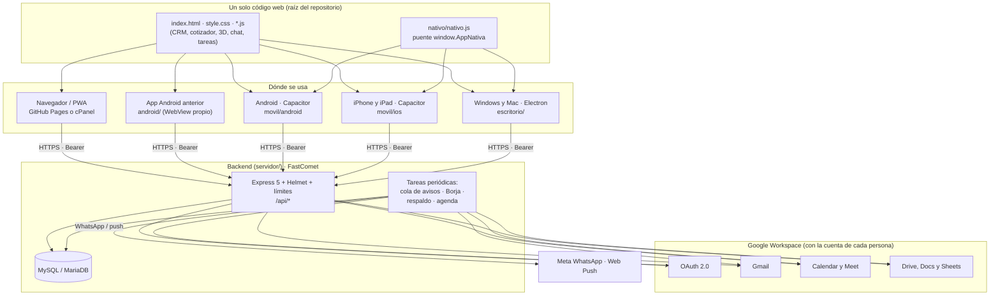
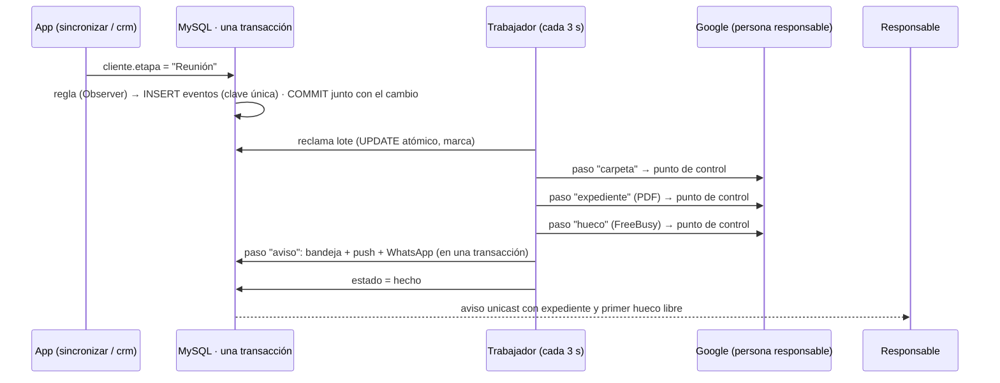

# Semences del Caribe · Sistema completo (web, móvil, escritorio y backend)

> **Documento maestro de la arquitectura híbrida** del CRM de Semences del Caribe: una sola app web que funciona en
> el navegador, en **Android, iPhone y iPad** (Capacitor) y en **Windows y Mac** (Electron), con un backend
> **Node.js + MySQL** conectado a **Google Workspace**. Incluye el manual para configurar Google Cloud, todas las
> variables de entorno y cómo se compila y se reparte cada app.
>
> Complementa a `DOCUMENTACION_COMPLETA.md` (arquitectura interna de la web y del backend, modelo de permisos y
> auditoría de noviembre de 2026). Guías de despliegue: `servidor/LEEME.md` (FastComet) y `android/LEEME.md`.

---

## Índice

1. [La arquitectura en una página](#1-la-arquitectura-en-una-página)
2. [Un código web, cinco envoltorios](#2-un-código-web-cinco-envoltorios)
3. [El puente nativo (window.AppNativa)](#3-el-puente-nativo-windowappnativa)
4. [Inicio de sesión con Google en todas las plataformas](#4-inicio-de-sesión-con-google-en-todas-las-plataformas)
5. [Backend: seguridad (bloque 1)](#5-backend-seguridad-bloque-1)
6. [Google Workspace: Drive, Calendar y Gmail (bloque 2)](#6-google-workspace-drive-calendar-y-gmail-bloque-2)
7. [Manual: configurar Google Cloud y Google Workspace](#7-manual-configurar-google-cloud-y-google-workspace)
8. [Variables de entorno](#8-variables-de-entorno)
9. [Apps móviles con Capacitor (bloque 3)](#9-apps-móviles-con-capacitor-bloque-3)
10. [Apps de escritorio con Electron (bloque 4)](#10-apps-de-escritorio-con-electron-bloque-4)
11. [Compilación automática y descargas (GitHub Actions)](#11-compilación-automática-y-descargas-github-actions)
12. [Pasar de la app Android anterior a la nueva](#12-pasar-de-la-app-android-anterior-a-la-nueva)
13. [Pruebas y verificación](#13-pruebas-y-verificación)
14. [Decisiones, límites y próximos pasos](#14-decisiones-límites-y-próximos-pasos)
15. [Motor de eventos y flujos automáticos (ARM)](#15-motor-de-eventos-y-flujos-automáticos-arm)
16. [Subir a semillasdata.com (FastComet): el día del despliegue](#16-subir-a-semillasdatacom-fastcomet-el-día-del-despliegue)
17. [Fase 2: pedidos por casa y variedad, privacidad y recompra](#17-fase-2-pedidos-por-casa-y-variedad-privacidad-y-recompra)
18. [Lote A: del pedido al campo](#18-lote-a-del-pedido-al-campo)
19. [Lote B: Torre de control del Master](#19-lote-b-torre-de-control-del-master)

---

## 1. La arquitectura en una página



| Capa | Tecnología | Carpeta | Se publica en |
|---|---|---|---|
| App web (PWA) | HTML/CSS/JS sin compilar, Three.js r128, jsPDF 4.2.1 (con SRI) | raíz | GitHub Pages (`publicar.yml`) o cPanel |
| Android | Capacitor 8.5.3 (Gradle, JDK 21, SDK 36, mínimo Android 7) | `movil/android` | Releases (APK firmado) |
| iPhone y iPad | Capacitor 8.5.3 (Xcode, Swift Package Manager, iOS 15+) | `movil/ios` | Xcode → TestFlight / App Store (cuenta de Apple) |
| Windows y Mac | Electron 44.9.3 + electron-builder 26.17.0 | `escritorio` | Releases (`.exe`, `.dmg`, `.zip`) |
| Android anterior | WebView propio en Java, sin Gradle (con widget) | `android` | GitHub Pages (`Semences.apk`) |
| Backend | Node 22/24, Express 5, Helmet 8, express-rate-limit 8, mysql2, `@googleapis/*` | `servidor` | FastComet (Passenger) |

---

## 2. Un código web, cinco envoltorios

Todas las plataformas ejecutan **los mismos archivos de la web**. Las apps los llevan dentro (abren sin conexión) y
cambian solo lo que depende del sistema: cómo se entra con Google, cómo se guarda un PDF y el botón "atrás".

| | Navegador / PWA | Android anterior | Android (Capacitor) | iPhone / iPad (Capacitor) | Windows / Mac (Electron) |
|---|---|---|---|---|---|
| Origen (debe estar en `ORIGENES`) | `https://semillasdata.com`, GitHub Pages | `https://appassets.androidplatform.net` | `https://localhost` | `capacitor://localhost` | `app://semences` |
| Librerías | CDN jsDelivr con SRI | dentro del APK | dentro de la app | dentro de la app | dentro de la app |
| Entrar con Google | página de Google y vuelta a la web | Chrome → `semences://sesion` | Custom Tabs → `semences://sesion` | Safari → `semences://sesion` | navegador del sistema → `semences://sesion` |
| Cotización en PDF | descarga del navegador | carpeta Descargas | menú de compartir (WhatsApp, Drive, Archivos…) | menú de compartir / Guardar en Archivos | "Guardar como" (Descargas) |
| Avisos con la app cerrada | Web Push | WhatsApp | WhatsApp | WhatsApp | WhatsApp |
| Sin conexión | service worker + copia local | copia local | copia local | copia local | copia local |
| Widget | — | sí | — | — | — |

`herramientas/preparar-web.mjs` prepara la copia de la web para cada app: cambia las URLs del CDN por `lib/` (las
mismas versiones, byte a byte), quita los `integrity`, añade `nativo.js` antes que los demás scripts (y `android.js`
en Capacitor), escribe la dirección del backend (`SEMENCES_API`) y deja fuera el service worker.

---

## 3. El puente nativo (window.AppNativa)

`googleSync.js` deja `window.AppNativa = window.AppNativa || window.AndroidApp || null`. Así la app web habla igual
con la app Android anterior (objeto Java `AndroidApp`) que con Capacitor y Electron (`nativo/nativo.js`):

| Función | Qué hace | Capacitor | Electron |
|---|---|---|---|
| `plataforma` | `android`, `ios` o `escritorio` | `Capacitor.getPlatform()` | `'escritorio'` |
| `abrirExterno(url)` | Abre el inicio de sesión de Google fuera de la app | plugin Browser | `shell.openExternal` (solo `https:`) |
| `tomarVueltaGoogle()` | `{ codigo, error }` de `semences://sesion`, una sola vez | plugin App (`appUrlOpen`, `getLaunchUrl`) | `open-url` (Mac) / argumentos (Windows) |
| `guardarArchivo(nombre, b64, tipo)` | Guarda la cotización | Filesystem (caché) + Share | diálogo "Guardar como" |
| `actualizarWidget(json)` | Widget de la pantalla de inicio | no hace nada | no hace nada |

`nativo.js` también pone las clases `app-nativa` y `app-<plataforma>` en `<html>` (estilos táctiles en `style.css`)
y, en Android, conecta el botón "atrás" con `window.atrasAndroid()` (cierra diálogos, paneles y menús antes de salir).

---

## 4. Inicio de sesión con Google en todas las plataformas

Google **no permite** entrar desde dentro de un WebView ni de una ventana de Electron ("navegador no seguro"). Por eso
el inicio de sesión siempre pasa por el **navegador del sistema** y vuelve a la app con un enlace propio:

```mermaid
sequenceDiagram
    participant A as App (web, móvil o escritorio)
    participant N as Navegador del sistema
    participant B as Backend
    participant G as Google
    A->>A: verificador aleatorio (se queda en la app) · reto = SHA-256
    A->>N: /api/auth/google/inicio?reto&cuenta=empresa|personal|conectar
    N->>B: inicio
    B->>G: redirección (state firmado; permisos según la cuenta)
    G->>B: /api/auth/google/vuelta?code&state
    B->>B: comprueba la cuenta · código de un solo uso (2 min) atado al reto
    B->>N: web: …#google-codigo=… · apps: semences://sesion?codigo=…
    N->>A: el sistema abre la app con el enlace
    A->>B: /api/auth/canjear { codigo, verificador }
    B-->>A: sesión (Bearer, 30 días)
```

**Tres botones, tres autorizaciones** (`google.js › opcionesAutorizacion`):

| Botón | Para quién | Permisos que pide | Verificación de Google |
|---|---|---|---|
| **Entrar con tu cuenta @empresa** (principal) | cuentas del Workspace | identidad + Gmail (enviar), Calendar y Drive **solo de los archivos de la app** (`drive.file`) | sí: la pantalla es **Externa** (hay cuentas @gmail.com en el equipo); `drive.file` no es un permiso restringido |
| **Entra con tu cuenta personal de Google** (opción B) | Gmail u otras cuentas personales | solo identidad (`openid email profile`) | **nunca** (permisos básicos) |
| **Conectar Gmail, Calendar y Drive** (en Cuenta) | quien entró con la opción B y quiera esas funciones | los de Workspace | sí, para cuentas externas (ver 7.3) |

Toda cuenta nueva —de la empresa o personal— entra en la **sala de espera** hasta que un Master le asigna cargo,
países y casas comerciales; en *Equipo y accesos* las personales aparecen marcadas como "cuenta personal".
`CUENTAS_PERSONALES=no` vuelve a cerrar la entrada a la empresa (`DOMINIO`), los `ADMINS` y la tabla `equipo`.

---

## 5. Backend: seguridad (bloque 1)

| Capa | Qué hay | Dónde |
|---|---|---|
| Cabeceras HTTP | **Helmet 8.3**: CSP `default-src 'none'` (es una API JSON), HSTS 1 año, `X-Frame-Options`, `frame-ancestors 'none'`, `no-referrer`, `nosniff`, sin `X-Powered-By`, `Cache-Control: no-store` | `src/seguridad.js` |
| Límite de peticiones | **express-rate-limit 8.7.1**: 600/min por IP en toda la API · 20/min por IP en la entrada · 240/min **por sesión** en las acciones (una oficina comparte IP). Cabeceras `RateLimit` estándar y respuesta `429 { codigo: 'limite' }` | `src/seguridad.js` |
| Entrada de datos | Cuerpo JSON objeto (≤ 10 MB), sin `__proto__`/`constructor`/`prototype` a ninguna profundidad, anidamiento ≤ 32, nombre de acción `[a-zA-Z]{1,40}`; validación propia de cada acción (correos, teléfonos, fechas, tamaños, tipos de archivo) | `src/seguridad.js`, `src/acciones.js` |
| Webhook de Instagram (Meta) | `POST /api/instagram/webhook` pasa por el límite general y la validación de entrada; la firma `X-Hub-Signature-256` se comprueba sobre el cuerpo original (`req.cuerpoCrudo`) con `META_APP_SECRET`; sin firma válida, 401 | `src/aplicacion.js`, `src/instagram.js` |
| SQL | Todas las consultas con parámetros (`?`); `multipleStatements: false`; módulos validados contra una lista. Probado con textos `'); DROP TABLE …` | `src/db.js` |
| Configuración | Esquema de todas las variables (`validarEntorno`): lo peligroso impide arrancar; lo mal escrito se avisa | `src/config.js`, `.env.example` |
| Sesiones y tokens | Huellas SHA-256 en la base; tokens de Google con AES-256-GCM atados a su dueño; PKCE en las apps | `src/cuentas.js`, `src/cifrado.js` |

> **Sobre DDoS:** el límite de peticiones frena abusos y fuerza bruta contra la app, pero un ataque de volumen satura
> la red antes de llegar a Node. Para eso hace falta la protección del hosting o un proxy como **Cloudflare** delante de
> `api.semillasdata.com`. El límite está en memoria: con varios procesos de Passenger, cada uno cuenta por separado.

---

## 6. Google Workspace: Drive, Calendar y Gmail (bloque 2)

El backend usa las **librerías oficiales de Google** en su forma modular (`@googleapis/gmail`, `calendar`, `drive`,
`docs`, `sheets` y `google-auth-library`): son el mismo proyecto `googleapis`, separado por servicio, para no instalar
los ~100 MB del paquete completo en el hosting compartido. Todo lo de Google pasa por `src/google.js` (en las pruebas
se cambia por uno simulado) y por `conGoogle()` (reintentos y reconexión, `src/llamadasGoogle.js`).

| Función | Cómo | Con qué cuenta | Cuándo |
|---|---|---|---|
| **Documentos del cliente** (Drive) | Certificados fitosanitarios, permisos de importación, análisis de germinación, facturas, fotos → carpeta del cliente en *Semences del Caribe · CRM › Clientes* (PDF, imagen, Word, Excel, CSV; 8 MB); quien sube recibe **lectura** de esa carpeta | la del sistema (Master) | botón *Documentos en Drive* del expediente (`subirDocumento`, `documentos`) |
| **Reportes PDF** (Docs + Drive) | Plantilla con `{{campos}}` → PDF en la carpeta del cliente | la de quien lo pide | botón *Reporte PDF en Drive* (`reporte`) |
| **Respaldo del CRM** (Drive) | Todo el CRM en un JSON (`semences-crm-respaldo-AAAA-MM-DD-HHMM.json`) en *Semences del Caribe · CRM › Respaldos*; borra los de más de `RESPALDO_CONSERVAR` días (`RESPALDOS=no` lo apaga) | la del sistema | cada día a `RESPALDO_HORA`; un Master, a mano (`respaldar`) |
| **Exportar a Sheets** | Una pestaña por módulo, la misma hoja cada vez | la de quien exporta | menú › *Exportar el CRM* (`exportar`) |
| **Agenda del CRM** (Calendar) | Seguimientos de clientes (míos o sin asignar), mis tareas, los trasplantes del germinador y la llegada estimada de los envíos de DHL y FedEx sin entregar (al vendedor, solo los de sus clientes, como en el resumen de Borja), de hoy a 60 días, como eventos de día completo que no marcan "ocupado". Cada evento lleva su clave privada: **sincronizar otra vez actualiza o borra, nunca duplica** | la de cada persona | cada mañana a las 6:00 (`AGENDA_AUTOMATICA`); a mano en *Cuenta* (`sincronizarAgenda`) |
| **Reuniones** (Calendar + Meet) | Evento con Meet e invitación al cliente; aviso de horario ocupado | la de quien agenda | expediente del cliente, tablero |
| **Correos** (Gmail) | Cotizaciones con el PDF adjunto | la de quien envía | cotizador (`correo`) |
| **Correos de aviso** (Gmail) | Solicitud de acceso (a los Master), acceso aprobado (a la persona), germinación baja (al equipo técnico del lote). Uno por destinatario, en segundo plano | la del sistema | automático (`CORREOS_AVISOS`) |
| **Resumen de Borja** | Incluye la agenda de Calendar del día | la de cada persona | cada mañana a `RESUMEN_HORA` |

La **cuenta del sistema** (`CUENTA_GOOGLE_SISTEMA`) es una persona del equipo —mejor un Master— que entró en la app
con Google conectado. No hace falta cuenta de servicio ni delegación de dominio, y funciona igual con cuentas
personales. Si esa persona retira el permiso, los respaldos y los correos de aviso se paran (el registro del
servidor lo dice) hasta que vuelva a conectar Google.

---

## 7. Manual: configurar Google Cloud y Google Workspace

> Lo hace **una vez** un administrador del Workspace de la empresa, en <https://console.cloud.google.com>.

### 7.1 Proyecto y APIs

1. Selector de proyectos › **Proyecto nuevo** › nombre `Semences CRM` › Crear.
2. **APIs y servicios › Biblioteca** y activar, una a una: **Gmail API**, **Google Calendar API**, **Google Drive API**,
   **Google Docs API** y **Google Sheets API**.

### 7.2 Pantalla de consentimiento (Google Auth Platform)

Menú › **Google Auth Platform** (antes "Pantalla de consentimiento de OAuth"):

1. **Branding**: nombre `Semences del Caribe`, correo de asistencia, logotipo (`iconos/icono-512.png`), página
   principal (`https://semillasdata.com`), **dominios autorizados**: `semillasdata.com`, y correo de contacto.
2. **Audience** (público):
   - Solo cuentas de la empresa → **Interno**. Sin verificación, sin límites. Pon `CUENTAS_PERSONALES=no`.
   - Empresa **y** cuentas personales (opción B, lo pedido) → **Externo** y estado de publicación **En producción**.
     Las cuentas personales entran solo con su identidad, que **no necesita verificación** (Google no muestra avisos
     ni aplica límites a `openid`, `email` y `profile`).
3. **Data access** (acceso a datos) › *Add or remove scopes*: añade los permisos que usa el backend
   (`servidor/src/google.js › PERMISOS`):

   | Permiso | Para qué | Categoría de Google |
   |---|---|---|
   | `openid`, `email`, `profile` | Identidad | básica |
   | `gmail.send` | Enviar cotizaciones y avisos (no puede leer el correo) | sensible |
   | `calendar.events` | Eventos, reuniones de Meet y agenda del CRM | sensible |
   | `calendar.freebusy` | Saber si una hora está ocupada (sin ver qué hay) | sensible |
   | `drive.file` | Solo los archivos que crea la app: carpetas del CRM, plantillas, PDF, documentos, respaldos y la hoja de exportación (Docs y Sheets lo aceptan para esos archivos) | **no sensible** |

   Desde la salida a producción ya no se piden `drive` (restringido) ni `documents` (sensible): con `drive.file` la
   app no puede leer nada del Drive de nadie que no haya creado ella (7.5).

### 7.3 Que las cuentas de la empresa no vean avisos con la app Externa

Con la app **Externa** y sin verificar, Google muestra "Google no ha verificado esta app" al pedir permisos sensibles o
restringidos y limita a **100 personas** el total de usuarios. Para las cuentas de la empresa se evita así:

1. <https://admin.google.com> › **Seguridad › Acceso y control de datos › Controles de API** › *Administrar acceso de
   apps de terceros* › **Configurar app nueva** › busca el **ID de cliente** (7.4) › ámbito: toda la organización ›
   **De confianza**.
2. Desde ese momento, las cuentas del Workspace dan todos los permisos sin avisos y sin contar para el límite.

Las **cuentas personales** que pulsen *Conectar Gmail, Calendar y Drive* sí verán el aviso (y cuentan para el límite de
100) hasta que la app pase la **verificación de Google** (Google Auth Platform › *Verification center*: verificación de
marca, vídeo de demostración y justificación de `gmail.send` y `calendar.events`). Con `drive.file` **ya no hace falta
la evaluación de seguridad anual** (CASA) que exigía el permiso `drive` completo. Para la revisión, las páginas
`privacidad.html` y `condiciones.html` explican el uso de cada permiso. Si no hace falta que el personal externo use
esas funciones, no hay que verificar nada: entran y trabajan con su identidad.

### 7.4 Credenciales

1. **Google Auth Platform › Clients › Create client** › tipo **Aplicación web** › nombre `Backend Semences`.
2. **URI de redirección autorizados**: `https://api.semillasdata.com/api/auth/google/vuelta` (la `URL_PUBLICA` del
   backend + `/api/auth/google/vuelta`). No hacen falta orígenes de JavaScript.
3. Copia el **ID de cliente** y el **secreto** en `GOOGLE_CLIENT_ID` y `GOOGLE_CLIENT_SECRET` (cPanel, nunca en el
   repositorio).

> **No hace falta** un cliente OAuth para Android, iOS ni escritorio: todas las apps entran a través del backend (el
> cliente "Aplicación web") y vuelven con `semences://sesion`, protegido con PKCE.

### 7.5 Carpetas de Drive (`drive.file`: no se crea nada a mano)

La app pide a Google el permiso mínimo de Drive, **`drive.file`**: solo ve los archivos que crea ella, nunca el resto
del Drive de nadie (no es un permiso "restringido", así que la verificación de Google es la normal, sin auditoría de
seguridad externa). Por eso todo el Drive del CRM lo crea y guarda **la cuenta del sistema (el Master)**
(`src/drive.js`), en su *Mi unidad*, la primera vez que el servidor arranca con esa cuenta conectada:

```
Semences del Caribe · CRM/
  Clientes/      una carpeta por cliente: documentos, reportes PDF y expedientes
  Reportes/      reportes sin cliente
  Respaldos/     respaldo diario (JSON); solo el Master tiene acceso
  Plantillas/    "Plantilla base del expediente" y la de cada casa comercial (copias de la base)
```

- Los ids se guardan en `ajustes` (clave `drive`). Las carpetas se reconocen por su marca (`appProperties`), no por
  el nombre: se pueden renombrar o mover dentro de la raíz. Si alguien las borra, se vuelven a crear solas.
- **Diseño de la empresa:** el Master abre *Plantillas › Plantilla base del expediente* en Google Docs y le da el
  formato (logo, colores) sin quitar los `{{campos}}`. Las plantillas de cada casa comercial se copian de ella la
  primera vez que hacen falta y cada casa puede retocar la suya.
- **Quién ve qué:** cuando alguien sube un documento, abre los documentos o genera un reporte de un cliente que
  puede ver (su país y su casa), recibe acceso de **lectura** a la carpeta de ese cliente, sin correo de Google. Los
  cambios entran siempre por la app (y quedan en la auditoría). Respaldos y plantillas no se comparten.
- Las variables `REPORTE_PLANTILLA_ID`, `REPORTE_CARPETA_ID`, `DOCUMENTOS_CARPETA_ID` y `RESPALDO_CARPETA_ID` ya no
  se usan (si siguen en el `.env`, el arranque solo lo avisa). Las carpetas hechas a mano antes de este cambio siguen
  donde estaban, pero la app ya no las ve: lo que haga falta conservar se sube de nuevo desde la app.
- Si el Workspace del Master prohíbe compartir fuera del dominio, las personas con @gmail.com no podrán abrir los
  enlaces (la subida sí funciona y queda en el registro del servidor): en la consola de Google Workspace, permitir
  compartir con cuentas externas de confianza.

### 7.6 Cuenta del sistema

1. Un Master entra en la app con su cuenta de Google (botón principal, con todos los permisos).
2. Su correo va en `CUENTA_GOOGLE_SISTEMA`. Reinicia la app Node en cPanel: a los pocos segundos aparece en su Drive
   la carpeta *Semences del Caribe · CRM* (7.5).
3. Comprueba en `https://api.semillasdata.com/api/salud` que `integraciones` dice `documentos`, `reportes`,
   `respaldos` y `correos: true`.
4. Si se cambia de cuenta del sistema, la nueva empieza su propia estructura (la anterior sigue en el Drive de la otra
   cuenta, que puede compartirla a mano).

### 7.7 Orígenes de las apps

`ORIGENES` vacía ya incluye la web, GitHub Pages y las cuatro apps. Si la personalizas, mantén:
`https://appassets.androidplatform.net,https://localhost,capacitor://localhost,app://semences`.

---

## 8. Variables de entorno

Todas están documentadas, con su formato, en **`servidor/.env.example`**; al arrancar se comprueban con
`validarEntorno()` (`src/config.js`). Resumen:

| Grupo | Variables | Obligatoria | Por defecto |
|---|---|---|---|
| Servidor | `URL_PUBLICA` · `ORIGENES` · `URL_APP` | `URL_PUBLICA` (https) | orígenes de la web y de las 4 apps · primer origen |
| Base de datos | `MYSQL_HOST` · `MYSQL_PUERTO` · `MYSQL_USUARIO` · `MYSQL_CLAVE` · `MYSQL_BASE` | usuario y base | `localhost` · `3306` |
| Google: entrada | `GOOGLE_CLIENT_ID` · `GOOGLE_CLIENT_SECRET` · `DOMINIO` · `ADMINS` · `CUENTAS_PERSONALES` | id, secreto y `DOMINIO` o `ADMINS` | cuentas personales: `si` |
| Seguridad | `CLAVE_CIFRADO` · `DIAS_SESION` · `ENTRADAS_POR_MINUTO` · `PETICIONES_POR_MINUTO` · `ACCIONES_POR_MINUTO` | `CLAVE_CIFRADO` (`npm run clave`) | 30 · 20 · 600 · 240 |
| Zona y agenda | `ZONA_HORARIA` · `MINUTOS_REUNION` · `RESUMEN_HORA` · `UMBRAL_GERMINACION` | — | `America/Santo_Domingo` · 30 · 7 · 85 |
| Workspace automático y Drive del CRM | `CUENTA_GOOGLE_SISTEMA` · `RESPALDOS` · `RESPALDO_HORA` · `RESPALDO_CONSERVAR` · `CORREOS_AVISOS` · `AGENDA_AUTOMATICA` | — (sin ella, Drive y correos apagados) | — · `si` · 2 · 30 · `si` · `si` |
| Reporte semanal | `REPORTE_SEMANAL` · `REPORTE_HORA` · `REPORTE_RESUMEN_HORA` | — | `si` · 16 (viernes) · 8 (lunes) |
| Revisión con IA (Claude) | `ANTHROPIC_API_KEY` · `IA_MODELO` | — (sin clave, apagada) | — · `claude-opus-5-5` |
| Bandeja de Instagram | `META_APP_SECRET` · `META_VERIFY_TOKEN` · `META_VERSION` | — | — · — · `v21.0` |
| Envíos (DHL y FedEx) | `DHL_API_KEY` · `FEDEX_CLIENT_ID` · `FEDEX_CLIENT_SECRET` · `FEDEX_URL` · `RASTREO_MINUTOS` | — (las dos de FedEx van juntas) | — · — · — · `https://apis.fedex.com` · 60 (mínimo 15) |
| Google Chat | `CHAT_WEBHOOK` · `CHAT_TARJETAS` | — | — · `si` |
| Push | `VAPID_PUBLICA` · `VAPID_PRIVADA` · `VAPID_CONTACTO` | — (van juntas: `npm run vapid`) | — |
| WhatsApp | `WHATSAPP_TOKEN` · `WHATSAPP_TELEFONO_ID` · `WHATSAPP_PLANTILLA` · `WHATSAPP_IDIOMA` · `WHATSAPP_VERSION` · `WHATSAPP_PLANTILLA_CLIENTES` · `WHATSAPP_PLANTILLA_RESUMEN` | — (las tres primeras van juntas) | `es` · `v21.0` |

**Secretos de GitHub** (Settings › Secrets and variables › Actions): `SEMENCES_FIRMA` (keystore en base64),
`SEMENCES_CLAVE` (su contraseña) y `SEMENCES_API` (dirección del backend, que se escribe en las apps). Para firmar
las apps de Mac y Windows en el futuro: `CSC_LINK`/`CSC_KEY_PASSWORD` (certificado) y, para notarizar en Mac,
`APPLE_ID`, `APPLE_APP_SPECIFIC_PASSWORD` y `APPLE_TEAM_ID` (variables que lee electron-builder).

---

## 9. Apps móviles con Capacitor (bloque 3)

**Estructura:** `package.json` y `capacitor.config.json` en la raíz (Capacitor 8.5.3 y los plugins App, Browser,
Filesystem y Share); los proyectos nativos en `movil/android` y `movil/ios` (rutas fijadas en la configuración para
no chocar con `android/`, la app anterior). `www/` se genera y no va al repositorio.

**Configuración nativa:**

| | Android (`movil/android`) | iPhone y iPad (`movil/ios`) |
|---|---|---|
| Id | `com.semencesdelcaribe.crm` (el mismo de la app anterior) | `com.semencesdelcaribe.crm` |
| Versión | 2.0.0 · `versionCode` 200 + número de compilación | 2.0.0 (200) |
| Mínimo | Android 7 (API 24) · compila con API 36 | iOS 15 · iPhone **y** iPad (`TARGETED_DEVICE_FAMILY 1,2`) |
| Red | `INTERNET`, `ACCESS_NETWORK_STATE`; sin tráfico sin cifrar | solo HTTPS (ATS por defecto); exenta de la declaración de cifrado |
| Almacenamiento | `READ/WRITE_EXTERNAL_STORAGE` solo hasta Android 9 (desde el 10 no hace falta permiso) | el menú de compartir guarda en Archivos sin permisos |
| Vuelta de Google | `intent-filter` `semences://sesion`, `launchMode singleTask` | `CFBundleURLTypes` → `semences` |
| Pantalla | iconos adaptables y pantalla de inicio de la marca | icono 1024, pantalla de inicio 2732, todas las orientaciones en iPad, multitarea (Split View) |
| Firma | la misma clave que la app anterior (secretos de GitHub) | equipo de Apple Developer en Xcode |

**Táctil:** botones de al menos 44 px en teléfonos y tabletas, sin menú del sistema al mantener pulsado, márgenes
seguros de la muesca, `touch-action: manipulation` (sin retraso del doble toque) y la vista de tarjetas del CRM en
pantallas estrechas.

**Compilar en un ordenador:**

```bash
npm ci
npm run movil:sync                 # prepara www/ y la copia a los dos proyectos
SEMENCES_API=https://api.semillasdata.com npm run movil:sync   # con el backend
npm run android:apk                # APK (necesita Android Studio o el SDK y JDK 21)
npm run ios:abrir                  # abre Xcode (solo en Mac)
```

**iPhone y iPad para producción** (en un Mac con Xcode 26 o posterior):

1. Cuenta de **Apple Developer Program** (99 USD al año) de la empresa.
2. `npm run ios:abrir` › proyecto *App* › *Signing & Capabilities* › **Team** de la empresa (firma automática).
3. En <https://appstoreconnect.apple.com>, crea la app con el id `com.semencesdelcaribe.crm`.
4. Xcode › *Product › Archive* › *Distribute App*: **TestFlight** para probar con el equipo, **App Store** (pública o
   no listada) o **Apple Business Manager** (app personalizada, solo para la empresa).

El proyecto ya compila: GitHub Actions lo compila en cada cambio para el Simulador (iPhone y iPad) sin firmar.

---

## 10. Apps de escritorio con Electron (bloque 4)

`escritorio/` tiene su propio `package.json` (Electron 44.9.3 y electron-builder 26.17.0, versiones fijas).

| Pieza | Qué hace |
|---|---|
| `main.cjs` | Ventana; protocolo `app://semences` (sirve `web/` sin salir de ella); CSP; solo navega dentro de la app; enlaces externos al navegador; permisos del navegador limitados a avisos y portapapeles; una sola copia abierta; registra `semences://` para la vuelta de Google |
| `preload.cjs` | Puente mínimo con aislamiento de contexto y sandbox: `abrirExterno`, `guardarArchivo`, `alRecibirEnlace`, `tomarEnlacePendiente` |
| `recursos/icono.png` | Icono 1024 px (de él salen el `.ico` y el `.icns`) |
| `package.json › build` | Windows: instalador **NSIS x64 en español**, accesos directos, carpeta a elegir. Mac: **dmg y zip** para Intel y Apple Silicon, firma ad-hoc |

```bash
cd escritorio
npm ci
npm start              # probar (prepara web/ y abre la app)
npm run dist:win       # instalador de Windows (en Linux necesita Wine)
npm run dist:mac       # dmg/zip (en un Mac)
```

**Firma de código (recomendada antes de repartir a mucha gente):**

- **Windows:** sin certificado, SmartScreen avisa ("Más información › Ejecutar de todas formas"). Con un certificado
  de firma de código (o Azure Trusted Signing) y `CSC_LINK`/`CSC_KEY_PASSWORD`, el aviso desaparece.
- **Mac:** hoy va con firma **ad-hoc** (abre en Apple Silicon; la primera vez, clic derecho › Abrir). Con un
  certificado *Developer ID Application* (cuenta de Apple Developer) y la notarización, se abre sin avisos: quita
  `"identity": "-"`, pon `hardenedRuntime: true` y las variables `CSC_LINK`, `APPLE_ID`, `APPLE_APP_SPECIFIC_PASSWORD`
  y `APPLE_TEAM_ID`.

---

## 11. Compilación automática y descargas (GitHub Actions)

| Flujo | Cuándo | Qué hace |
|---|---|---|
| `publicar.yml` | cada cambio en `main` | pruebas (Node 22 y 24, MySQL 8.4 y MariaDB 10.11, web) → APK anterior → web en GitHub Pages |
| `multiplataforma.yml` | ramas `auditoria/**` y `apps/**`, etiquetas `v*`, o a mano | pruebas → en paralelo: **Android** (APK firmado y comprobado), **iOS** (Simulador), **Windows** (`.exe`), **Mac** (`.dmg`/`.zip` con firma ad-hoc comprobada) → **versión de prueba en Releases** con todos los archivos |

La firma del APK nuevo **se compara con la del APK publicado**: si no coincidiera, la app no se instalaría encima y el
flujo se detiene sin publicar nada.

**Descargas:** <https://github.com/zandynicasiop-debug/semences-crm/releases> (cada compilación crea una versión de
prueba `v2.0.0-beta.N` con enlaces directos a cada archivo). La primera completa es
[`v2.0.0-beta.4`](https://github.com/zandynicasiop-debug/semences-crm/releases/tag/v2.0.0-beta.4):

| Plataforma | Descarga directa | Tamaño |
|---|---|---|
| Android | [Semences-2.0.0-Android.apk](https://github.com/zandynicasiop-debug/semences-crm/releases/download/v2.0.0-beta.4/Semences-2.0.0-Android.apk) | 4,6 MB |
| Windows (x64) | [Semences-2.0.0-Windows-x64.exe](https://github.com/zandynicasiop-debug/semences-crm/releases/download/v2.0.0-beta.4/Semences-2.0.0-Windows-x64.exe) | 116 MB |
| Mac (Apple Silicon) | [Semences-2.0.0-Mac-arm64.dmg](https://github.com/zandynicasiop-debug/semences-crm/releases/download/v2.0.0-beta.4/Semences-2.0.0-Mac-arm64.dmg) | 126 MB |
| Mac (Intel) | [Semences-2.0.0-Mac-x64.dmg](https://github.com/zandynicasiop-debug/semences-crm/releases/download/v2.0.0-beta.4/Semences-2.0.0-Mac-x64.dmg) | 132 MB |
| iPhone/iPad (Simulador de Xcode) | [Semences-2.0.0-iOS-Simulador.zip](https://github.com/zandynicasiop-debug/semences-crm/releases/download/v2.0.0-beta.4/Semences-2.0.0-iOS-Simulador.zip) | 3,4 MB |

Los cambios que solo tocan documentación (`.md`) no vuelven a compilar las apps.

---

## 12. Pasar de la app Android anterior a la nueva

- **Se instala encima** (mismo id, misma firma, versión mayor): no hace falta desinstalar.
- **Los datos guardados en el teléfono no pasan** (la app nueva usa otro origen, `https://localhost`): antes de
  actualizar, abre la app anterior **con conexión** y espera a que diga *sincronizado*. Después, en la nueva, se entra
  otra vez con Google y todo baja del servidor.
- **Widget:** la app nueva todavía no lo tiene (ver 14).
- Las dos apps pueden convivir mientras el equipo prueba: la anterior sigue publicándose desde `main`.

---

## 13. Pruebas y verificación

| Grupo | Archivo | Pruebas |
|---|---|---|
| Backend completo contra MySQL/MariaDB | `servidor/pruebas/api.test.js` | 38 por base |
| Unidades del backend | `servidor/pruebas/unidad.test.js` y `modulos.test.js` | 10 + 75 |
| App web | `pruebas-web/web.test.js` | 21 |

Comprobado además durante este trabajo:

- **Navegador (Chromium):** las llamadas CORS de la app siguen funcionando con Helmet; librerías con SRI; un jsPDF
  alterado se bloquea; cotización en PDF con jsPDF 4.2.1.
- **Escritorio (Electron real, pantalla virtual):** carga desde `app://semences`, sin Node en la página, CSP activa
  (bloquea scripts en línea), librerías locales, vuelta de Google por `semences://sesion` (una sola vez), no navega
  fuera de la app, no sirve archivos fuera de `web/`.
- **GitHub Actions:** APK de producción compilado y firmado con la clave de la app anterior; proyecto de iOS compilado
  para el Simulador; instalador de Windows y app de Mac con firma ad-hoc verificada.

---

## 14. Decisiones, límites y próximos pasos

| Tema | Estado | Siguiente paso |
|---|---|---|
| Librería de Google | Modular `@googleapis/*` (oficial) en vez del paquete completo `googleapis` | ninguno: misma API, menos peso |
| Avisos push en las apps | Las apps usan WhatsApp; Web Push solo en navegador/PWA | push nativo con Firebase Cloud Messaging (Android) y APNs (iOS): `@capacitor/push-notifications` |
| Widget en la app nueva | No portado | llevar `WidgetSemences.java` a `movil/android` con un plugin pequeño |
| iOS en un iPhone | Proyecto listo; falta la cuenta de Apple | Apple Developer Program → TestFlight |
| Firma de Windows y Mac | Sin certificado (SmartScreen / Gatekeeper avisan) | certificado de firma de código y notarización |
| Verificación de Google | No necesaria para empresa (de confianza) ni para entrar con cuenta personal | solo si personas externas deben usar Gmail/Drive |
| DDoS | Límites por IP y sesión en la app | Cloudflare (u otra protección de red) delante del backend |
| Avisos de npm en herramientas de compilación | `@capacitor/cli` y `electron-builder` arrastran avisos moderados de `glob`/`minimatch`/`uuid`; **no van dentro de las apps** (`npm audit --omit=dev`: 0) | actualizar cuando Capacitor y electron-builder publiquen versiones con las dependencias nuevas |
| Three.js r128 | Sin vulnerabilidades conocidas | migración a módulos ES como proyecto aparte |

---

## 15. Motor de eventos y flujos automáticos (ARM)

Arquitectura orientada a eventos sobre la misma base MySQL/MariaDB, sin servicios nuevos que mantener en el
hosting compartido (`servidor/src/eventos.js`, `flujos.js`, `cuotas.js`).



| Pieza | Qué garantiza |
|---|---|
| **Outbox transaccional** (`db.sincronizar › alConfirmar`) | El evento existe si, y solo si, el cambio se confirmó: una sincronización rechazada (permiso) no deja eventos |
| **Clave de idempotencia** (`UNIQUE clave`) | El mismo hecho no se encola dos veces (guardar otra vez, reintentos de la app sin conexión) |
| **Pasos con punto de control** (`paso(nombre, tarea)`) | Un reintento no repite lo que ya hizo: ni dos carpetas, ni dos PDF, ni dos avisos |
| **Reintentos** | 429, 5xx, red y tiempo agotado: espera exponencial con variación al azar (30 s, 1, 2, 4… min), hasta 6 intentos. Dentro de cada llamada a Google, además, los reintentos inmediatos de `conGoogle` |
| **Cola de mensajes muertos** | Lo definitivo (cliente borrado, sin manejador, nadie responsable) queda `fallido` con su motivo; `/api/salud › eventos` lo cuenta por tipo |
| **Tiempo de visibilidad** | Un evento que quedó `procesando` más de 10 minutos (proceso caído) se vuelve a reclamar; cada escritura lleva la marca del trabajador |
| **Aislamiento (unicast)** | El flujo comprueba al ejecutarse que el responsable sigue aprobado y ve ese cliente (país **y** casa); el aviso solo le llega a él |

**Flujo `CLIENTE_EN_REUNION`** (embudo: Prospecto → Contactado → **Reunión** → Propuesta → Cliente / Perdido):
carpeta del cliente en Drive → expediente PDF desde la plantilla → primer hueco libre de 30 min en 5 días
laborables (9:00–17:00, FreeBusy) → aviso al responsable. **Al cliente no se le invita automáticamente**: el
responsable confirma la hora con *Reunión con Meet* en la ficha. Cada paso de Google es opcional: sin cuenta
conectada o sin plantilla, queda "omitido" y el aviso sale igual.

**Añadir un disparador nuevo:** una regla en `REGLAS` (`flujos.js`: módulo, condición sobre registro y anterior,
y el evento con su clave) y su manejador en `MANEJADORES`, escrito con `paso()`. Se prueba como
`pruebas/api.test.js › ARM`.

**Cuotas:** `CuboDeFichas` (10 llamadas seguidas, luego 5 por segundo y persona) delante de **toda** llamada a Google:
lo pone `conGoogle` (`llamadasGoogle.js`) en cada intento, también en los reintentos, así que acciones, flujos,
agenda, respaldos y correos comparten la misma cuota; la agenda además espera turno en cada evento que crea o borra.
Si aun así Google frena, su cuota por minuto llega como **403** `userRateLimitExceeded`/`rateLimitExceeded` (no 429)
y se reintenta con espera (`motivosGoogle` en `reintentos.js` lee los motivos del cuerpo del error, que es un objeto);
la cuota diaria (`dailyLimitExceeded`) no. Un 403 por falta de permisos de la cuenta da "Vuelve a conectar tu cuenta";
un archivo de Drive sin acceso no (reconectar no lo arreglaría).
WhatsApp: los límites de Meta (códigos `130429`, `131056`, `80007`, `4`, `613`, que llegan como HTTP 400) se tratan
como pasajeros y la cola los reintenta con espera.

**Webhooks de Meta (Instagram y WhatsApp):** antes de responder solo se guarda lo recibido (unas pocas escrituras en
la base, para no perder nada); lo lento (pedir el perfil de Instagram, la respuesta de Borja por WhatsApp) sale en
segundo plano después del 200, así Meta no reintenta ni desactiva el webhook por lentitud.

**Tokens que Google renueva:** si no se pueden guardar (la base caída en ese momento), la llamada sigue y queda en
`stderr.log`; ningún fallo de ese aviso, ni ninguna promesa rechazada sin atender, detiene el servidor
(`process.on('unhandledRejection')` en `app.js`).

**Rotar `CLAVE_CIFRADO`** sin que nadie vuelva a entrar: `npm run clave` → en el panel, `CLAVE_CIFRADO_ANTERIOR` = la
de antes y `CLAVE_CIFRADO` = la nueva → reiniciar (cada token se vuelve a cifrar al usarse) → `npm run rotar-clave`
(todos de una vez) → quitar `CLAVE_CIFRADO_ANTERIOR`.

---


### Plantilla del expediente por casa comercial

Al pasar un cliente a "Reunión", el paso `plantilla` (`flujos.js › asegurarPlantillaCasaComercial`) busca en
*Semences del Caribe · CRM › Plantillas* (Drive del CRM, cuenta del sistema; 7.5) la plantilla de Docs de **su** casa comercial
(Gautier Semences, Hexagon Seeds, Genome Seeds o Fitó), reconocida por su marca en Drive (`appProperties
semencesPlantilla`), no por el nombre. Si no existe, la crea:

- como copia de la *Plantilla base del expediente* (el diseño de la empresa, que el Master edita en Docs);
- sin ella: un documento nuevo con los marcadores reales del expediente: `{{cliente}}`, `{{pais}}`, `{{casa}}`,
  `{{ubicacion}}`, `{{telefono}}`, `{{whatsapp}}`, `{{marca}}`, `{{seguimiento}}`, `{{procesos}}`, `{{visitas}}`,
  `{{rendimientos}}`, `{{responsable}}` y `{{fecha}}`. Una prueba comprueba que son exactamente los campos que
  rellena el expediente, así que el PDF nunca sale con un marcador vacío ni con datos inventados.

El documento nuevo solo se marca como plantilla cuando ya tiene el texto (si algo falla a medias se borra y se
reintenta), y el paso tiene su punto de control: no se busca ni se crea dos veces. Cada casa puede después darle
su formato en Docs; mientras conserve los `{{marcadores}}`, el expediente sale con sus datos. Sin cuenta del sistema
no se crea nada (no se reparten plantillas por el Drive personal de cada vendedor): esos pasos quedan "omitidos" y el
aviso al responsable sale igual. El reporte PDF de la ficha del cliente usa la misma plantilla de su casa.

### Cambios de etapa sin conexión (cola en IndexedDB)

La etapa se cambia en la ficha del cliente (selector "Etapa"). La app ya guardaba todo sin conexión (`datos.js`),
pero subía el registro entero: la copia vieja de un teléfono sin señal podía pisar lo que otra persona cambió en la
oficina. Ahora, para los cambios de etapa:

| Paso | Qué pasa |
|---|---|
| Sin conexión (`navigator.onLine === false`) o la subida falla por la red (`TypeError` de fetch) | El cambio se guarda en IndexedDB (`colaEtapas.js`) como `{ operacionId, clienteId, cambios: { etapa }, anterior: { etapa } }`. Si solo cambió la etapa, el registro entero ya no se sube |
| Vuelve la red (evento `online`), se abre la app o termina una sincronización | La cola sale sola a `POST /api/sincronizar-lote` en tandas de 100 |
| El servidor (`lotes.js`) | Aplica cada `operacionId` una sola vez (tabla `operaciones_lote`), cambia **solo la etapa** sobre el cliente tal como está en la base, con los mismos permisos, auditoría y disparadores (pasar a "Reunión" prepara la reunión) |
| Alguien ya movió ese cliente a otra etapa | Conflicto: no se pisa; la app avisa ("ahora: Cliente") y trae lo del servidor |
| Reporte semanal sin entregar (423) | No se aplica ni se pierde nada; se abre el reporte y la cola sale al entregarlo |
| Red caída, 5xx, 429 | Se queda en la cola y se reintenta |

Sin IndexedDB (algunos modos privados) no se intercepta nada y el cambio sigue el camino normal. Al cerrar sesión
la cola se vacía, como el resto de la copia local.

### Tipos (TypeScript, sin compilar)

`npx tsc --noEmit` (desde la raíz; o `npm run tipos`) comprueba en modo estricto los archivos con `// @ts-check`:
`eventos.js`, `flujos.js`, `cuotas.js`, `lotes.js`, `pedidos.js`, `campo.js`, `mensajes.js`, `panelCeo.js` y `agendaCeo.js` del servidor y `colaEtapas.js` de la web. El proyecto sigue
siendo JavaScript, sin paso de compilación en FastComet. GitHub Actions lo ejecuta en cada subida a `main` y, si
falla, no publica.
## 16. Subir a semillasdata.com (FastComet): el día del despliegue

Dos piezas en la misma cuenta de FastComet: el **backend** en `https://api.semillasdata.com` (app Node) y la **web**
en `https://semillasdata.com` (archivos en `public_html`). La primera vez, sigue antes `servidor/LEEME.md` ›
"Despliegue en FastComet" (Google Cloud, base de datos, subdominio). El orden importa: la web y las apps solo
salen conectadas cuando el backend ya responde y existe el secreto `SEMENCES_API`.

**0. Antes de tocar nada**
- [ ] Copia de la base (si ya existe): cPanel › phpMyAdmin › la base › **Exportar**.
- [ ] Copia de lo que haya: renombra la carpeta del backend (`semences-servidor` → `semences-servidor-anterior`) y
      descarga un zip de `public_html`. Es la vuelta atrás.
- [ ] A mano: `CLAVE_CIFRADO` (la de siempre; si se cambia, todos vuelven a conectar Google), `GOOGLE_CLIENT_ID`,
      `GOOGLE_CLIENT_SECRET` y los datos de MySQL.

**1. Backend (api.semillasdata.com)**
1. GitHub › Actions › "Compilar APK y publicar la app" › la última ejecución verde de `main` › **Artifacts** ›
   `Semences-para-FastComet`. Dentro: `semences-servidor.tar.gz` (el que se sube: el antivirus de FastComet
   rechaza los `.zip` con archivos `.js`), `semences-servidor.zip` y `semences-web-dominio.zip`.
2. cPanel › Setup Node.js App › la app › **Stop App**. File Manager: sube `semences-servidor.tar.gz` a
   `~/semences-servidor` (fuera de `public_html`) y **Extract**.
3. En la app Node: Node **22 o 24**, modo **Production**, archivo de inicio **`inicio.cjs`** (con `app.js`, LiteSpeed
   falla con `ERR_REQUIRE_ASYNC_MODULE`). Variables de entorno
   (todas en `servidor/.env.example`):
   - Obligatorias: `URL_PUBLICA`, `DOMINIO` y/o `ADMINS`, `MYSQL_*`, `GOOGLE_CLIENT_ID`, `GOOGLE_CLIENT_SECRET`,
     `CLAVE_CIFRADO`. `ORIGENES` vacía ya acepta semillasdata.com, GitHub Pages y las apps.
   - Opcionales de esta versión: `CUENTA_GOOGLE_SISTEMA` (el Master: Drive del CRM, expediente PDF al pasar a
     "Reunión", respaldos y correos), `ANTHROPIC_API_KEY` (revisión de los reportes semanales). `CLAVE_CIFRADO_ANTERIOR`
     solo al rotar la clave.
4. **Run NPM Install** y **Start/Restart**.
5. `https://api.semillasdata.com/api/salud` → `"ok":true`, `"base":"ok"` y la clave `"eventos"`. Si la base venía de
   una versión anterior, el registro de la app dice `Base puesta al día (…)`: se añadieron las columnas nuevas sin
   tocar los datos. Si no arranca, el motivo está en ese registro (cPanel › Setup Node.js App, o `stderr.log`).
6. **Cron de cPanel (obligatorio):** cPanel › Cron Jobs › cada 5 minutos (`*/5 * * * *`):
   `curl -fsS --max-time 120 https://api.semillasdata.com/api/latido > /dev/null 2>&1`. Sin él, Passenger duerme
   Node y los flujos, avisos, Borja y clientes dormidos se paran hasta la siguiente visita (`servidor/LEEME.md`).

**2. Conectar la web y las apps**
1. GitHub › Settings › Secrets and variables › Actions › secreto `SEMENCES_API` = `https://api.semillasdata.com`.
2. Actions › "Compilar APK y publicar la app" › **Run workflow** (main). Al terminar, GitHub Pages y el APK ya
   salen conectados, y el artifact `Semences-para-FastComet` nuevo trae la web conectada (sin el secreto, la
   ejecución avisa: "El paquete web para FastComet va SIN CONEXIÓN").
3. Actions › "Apps nativas" › **Run workflow** (main): Windows, Mac, Android (Capacitor) e iOS conectados, en
   Releases.

**3. Web (semillasdata.com)**
1. Descarga el artifact nuevo (paso 2.2). File Manager › `public_html` (activa "Show Hidden Files") › sube
   `semences-web-dominio.zip` › **Extract**. Lleva su `.htaccess`: siempre https, `www` → sin `www` (el backend solo
   acepta `https://semillasdata.com`) e `index.html`/`sw.js` sin caché vieja. Trae también `Semences.apk` para el
   botón de descarga.
2. Si `public_html` ya tiene la web corporativa: usa un subdominio (p. ej. `app.semillasdata.com`), crea la
   variable del repositorio `SEMENCES_WEB` = `https://app.semillasdata.com`, añade ese origen a `ORIGENES` en el
   backend (junto con los de la lista por defecto que se usen) y repite el paso 2.2.

**4. Prueba final (10 minutos)**
- [ ] `https://semillasdata.com` en el ordenador y en el teléfono: carga sin avisos de "sin conexión".
- [ ] Entrar con una cuenta de la empresa y con una personal: la personal queda en la sala de espera.
- [ ] Un Master aprueba a alguien con su cargo, país y casa; esa persona ve solo lo suyo.
- [ ] Crear un cliente y pasarlo a "Reunión": al responsable le llega el aviso; `/api/salud` muestra
      `CLIENTE_EN_REUNION: { hecho: 1 }`.

**Volver atrás.** Stop App, borra `semences-servidor`, renombra `semences-servidor-anterior` a `semences-servidor`,
Restart. Si algo de la base falló, importa la copia del paso 0. La web: vuelve a extraer el zip de `public_html`.

## 17. Fase 2: pedidos por casa y variedad, privacidad y recompra

Sin tablas ni etapas nuevas: todo va sobre el módulo `pedidos` (en `registros`, estados Cotizado → Confirmado →
Entregado / Cancelado), `metas.js` y el motor de eventos. Las reglas están en `servidor/src/pedidos.js`.

**Un cliente, varias casas.** Cada pedido es una línea casa comercial + variedad del cliente. La ficha básica del
cliente (nombre, teléfono, WhatsApp, correo, ubicación) la ve el equipo de su **país** aunque sea de otra casa, para
no registrarlo dos veces: llega marcada `compartida`, sin su casa, marca que compra, etapa ni asignado, y no se puede
cambiar ni borrar (la web la muestra como "Ficha compartida"). Así un vendedor de Fitó registra su pedido al cliente
que ya trabaja Gautier.

**Privacidad de las ventas.** Pedidos y cotizaciones (cantidades y precios en US$) llevan `vendedor`, el correo de
quien los ejecuta: lo pone el servidor al crearlos y no cambia aunque otro los edite. Un vendedor solo ve y toca los
suyos, aunque sea de la misma casa; **administración** ve los de su país y casa (aprueba las cotizaciones y gestiona
pedidos y envíos) y puede registrar un pedido a nombre de un vendedor; el **Master** ve todo. Al arrancar, los
pedidos y cotizaciones de antes reciben su vendedor (el asignado del cliente, como contaban las metas, o quien los
creó), una sola vez.

**Confirmar.** Un pedido Confirmado o Entregado necesita semillas (miles) y precio por mil en US$ mayores que 0; el
servidor lo comprueba al pasar a ese estado o al cambiar esas cifras (400 con el motivo) y la web avisa en el campo.
Los confirmados antes de la regla pueden pasar a Entregado sin tocarlos.

**Ciclo de recompra.** Al pasar a Confirmado o Entregado se encola `PEDIDO_RECOMPRA` (una vez por pedido) para la
fecha del pedido + "Recompra en (días)" (90 si no se indica). Ese día, si el pedido sigue siendo venta, se abre un
pedido **Cotizado** para el mismo cliente, casa, variedad y vendedor, con las semillas del anterior como punto de
partida y el precio por confirmar, y le llega el aviso a su campana (y por push). Al confirmarlo, el ciclo sigue.
Cancelado antes de tiempo, no se reabre.

**Metas.** Las ventas cuentan para el vendedor que ejecuta el pedido. Indicador nuevo `ventasUsd` (Ventas en US$:
miles × precio por mil), y el avance trae el desglose del mes por casa comercial y variedad, que la web muestra en la
tarjeta de metas.

## 18. Lote A: del pedido al campo

Todo en `servidor/src/campo.js` (y `pedidos.js`), con el motor de eventos: cada automatismo es un evento con clave
única (no se repite) y pasos con punto de control (un reintento no duplica nada).

**Parámetros agronómicos** (tabla `ajustes`, clave `agronomia`; acción `ajustes`). Por defecto: bandejas de 128, 162 y
200 alvéolos (128 la de partida), 10 % de siembra extra, y por cultivo los días de vivero (tomate 28, pimiento 40, ají y
cebolla 35, melón, sandía, pepino y calabacín 18) y la densidad en plantas por hectárea (tomate 25.000, pimiento y ají
30.000, pepino 22.000, melón 12.000, sandía 5.000, cebolla 250.000, calabacín 10.000). Si a un cultivo le falta la
densidad (uno nuevo), la calculadora la pide a mano. Los lee todo el equipo; los cambian el Master y los técnicos en menú › **Parámetros agronómicos** (validados
y en la auditoría). Superficie: la tarea dominicana de 628,86 m² en RD y la hectárea en Venezuela.

**La regla de la siembra** (servidor y calculadora): el % extra se aplica una vez, al pasar de plantas a semillas.
Siembra = plantas × (1 + extra); bandejas = semillas ÷ alvéolos, hacia arriba. Un pedido de 22 mil semillas se siembra
entero: 172 bandejas de 128 y unas 20.000 plantas.

**#2 Pedido → plantulación.** Casilla "Con plantulación" en el pedido (desmarcada por defecto), con bandeja, cultivo y
fecha de entrega de las plántulas. Al confirmarse (o entregarse) se crea en el germinador un lote **Programado** con
sus bandejas y fechas: con fecha de entrega, siembra = entrega − días de vivero; sin ella, se siembra ya y la entrega es
siembra + vivero. Si ya va tarde, se siembra hoy, con prioridad alta y el aviso de cuándo había que sembrar. La siembra
queda como tarea con fecha del plantulador del país y casa (sale en su agenda y en su Google Calendar), y les llega el
aviso a él y al vendedor.

**#3 Entregado → visita técnica.** Cuando un envío pasa a Entregado (rastreo de DHL/FedEx o a mano), se crea una tarea de
visita de seguimiento a los 7 días para el técnico de su país y casa que ya trabaja con ese cliente (su última visita o
proceso); si no, el primero por nombre; sin técnicos, el vendedor asignado. Una vez por envío.

**#5 Clientes dormidos.** Cada hora: por cliente y casa, si pasaron los días de recompra del último pedido confirmado (90
por defecto) sin cotización ni pedido nuevo, aviso al vendedor que lo ejecutó (una vez por ese pedido). La recompra que
abre el sistema no cuenta como gestión mientras siga Cotizada y sin precio, y se dan 14 días desde que se abrió para que
la trabajen antes de avisar: así no llegan el mismo día el aviso de recompra y el de dormido.

**#11 Prioridades en US$ (Borja, 7:00).** Primer bloque del resumen: sus cotizaciones abiertas en US$ (pendientes o
aprobadas) y sus pedidos cotizados, de mayor a menor; las recompras ya abiertas sin precio se estiman con el precio del
pedido anterior (≈). En WhatsApp van en la misma variable que los seguimientos (la plantilla de Meta no cambia).

**#12 Viernes sin teclear.** El reporte semanal llega con lo hecho en el CRM esa semana: visitas registradas, cotizaciones
preparadas y pedidos confirmados (con la fecha en que se confirmaron), ya con estado y comentario ("Del CRM"). Se
entregan sin crear tareas, y el servidor comprueba que son de esa persona y de esa semana.

**#15 Calculadora agronómica** dentro del pedido: cultivo, superficie (tareas o hectáreas según el país), densidad y % extra
editables, bandeja → plantas, semillas (miles), bandejas y US$ (con el precio por mil del pedido). También al revés, de
semillas a superficie. "Pasar al pedido" rellena las semillas, el cultivo y la bandeja.

**Pedidos editables.** Los pedidos tienen botón **Editar** (para confirmar uno cotizado, trabajar la recompra o marcar la
plantulación). Al editar se respeta su casa comercial aunque el cliente sea de otra.

## 19. Lote B: Torre de control del Master

Menú del logo › **Torre de control** (`panelCeo.js` en la web; acción `panelCeo` en `servidor/src/panelCeo.js`). Solo la
ven y la usan los Master (ADMINS): el servidor rechaza a cualquier otro con 403. Cuatro tarjetas:

**Pendientes del equipo.** Cada persona aprobada (sin los Master), de más a menos pendientes: cotizaciones abiertas
(Pendientes o Aprobadas) y pedidos por cerrar (Cotizados) con sus US$, clientes en Reunión asignados, tareas vencidas y
si el reporte semanal la tiene bloqueada (el 423). **Revisión por Meet** en 1 clic: busca el primer hueco libre (FreeBusy)
del calendario del Master en los próximos 5 días laborables, crea el evento con Meet e invita a la persona (Google le
manda la invitación), con su lista de pendientes en la descripción, y le avisa en la campana.

**Briefings.** El resumen de hoy de cada persona: si salió, a qué hora y por qué canal (WhatsApp, push o correo). En
WhatsApp se ve además si **se entregó y si se leyó**: la cola guarda el id que devuelve Meta (`cola_avisos.remoto_id`) y el
webhook de WhatsApp recoge los estados `delivered`, `read` y `failed` (`statuses`, dentro del mismo campo `messages` al que
ya está suscrito). El push y el correo no informan de la lectura. **Volver a enviar ahora** a RD, VE o todos lo genera de
nuevo con los datos del momento.

**Borja.** Qué secciones lleva el resumen de la mañana (prioridades en US$, agenda, seguimientos, tareas, procesos,
germinador, envíos, mensajes y el consolidado de administración); cada persona sigue viendo solo lo de su ámbito.
**Generar resumen global ahora**: el consolidado de RD, Venezuela y el total (ventas del mes en US$ y miles,
cotizaciones abiertas y pedidos por cerrar con sus US$, recompras vencidas, clientes en Reunión, dormidos y reportes
bloqueados), en pantalla y en la campana, el push y el correo del Master.

**Mensajes.** Texto (campana, push y correo), asunto (el del correo del briefing) y hora (briefing de Borja y
recordatorio del viernes; vacía = la del servidor) de los mensajes automáticos: briefing, recordatorio del reporte,
recompra, cliente dormido y visita técnica. Variables por mensaje: `{{vendedor}}`, `{{cliente}}`, `{{casa}}`,
`{{variedad}}`, `{{fecha}}`, `{{dias}}`, `{{guia}}`, `{{lista_pendientes}}` y `{{agenda_dia}}` (el servidor rechaza las que no
valen en ese mensaje). Vista previa con datos de ejemplo y "Restaurar el de siempre". **WhatsApp:** Meta no deja que la
empresa inicie conversaciones con texto libre, así que solo se elige entre las **plantillas aprobadas**: con
`WHATSAPP_CUENTA_ID` (la cuenta de WhatsApp Business) se leen de Meta con sus variables; sin ella, se ofrecen las
configuradas en el servidor. El briefing admite una plantilla de 7 variables (varias líneas) o de 1 (una línea); el
recordatorio, de 1. Mientras nadie cambie nada, todo sale con los textos de siempre. Los cambios quedan en la auditoría.

**Mi agenda con Borja** (pestaña de la Torre de control; `servidor/src/agendaCeo.js`, tabla `agenda_ceo`). La agenda
privada de cada Master: cada uno ve y toca solo lo suyo (todas las consultas van por su usuario). En una sola vista:
sus cuatro listas (Mis Cosas, Finanzas, Supervisión Comercial y Seguimiento de Correos), su Google Calendar de hoy y
los pendientes del equipo (los del radar). Se le escribe a Borja en español y lo entiende sin IA (coste cero y siempre
la misma respuesta para el mismo texto):

| Orden | Qué hace |
|---|---|
| `finanzas: pagar el ITBIS el viernes (urgente)` | Lo anota en esa lista, con fecha y prioridad alta |
| `agenda reunión con Hexagon mañana a las 3 con compras@hexagon.com` | Cita en su Google Calendar, con invitación y Meet al invitado |
| `agenda revisión de cierre el 30 de noviembre` | Cita de todo el día |
| `correo a ana@semillasdata.com: Asunto \| Texto` | Lo envía desde su Gmail y lo deja en Seguimiento de Correos |
| `seguimiento a ana@semillasdata.com: ¿novedades?` | Responde en el mismo hilo de Gmail ("Re: …") |
| `listo: pagar el ITBIS` | Lo da por hecho (se puede reabrir) |
| `¿qué tengo hoy?` / `ayuda` | Cuántos pendientes tiene / qué sabe hacer |

Fechas: hoy, mañana, pasado mañana, días de la semana, 15/11, "30 de noviembre", AAAA-MM-DD; horas: "a las 3" (de 1 a 6,
por la tarde), "4pm", "15:30", "por la mañana/tarde"; duración: "por 1 hora". Lo de Google (Calendar y Gmail) va en
segundo plano: el ítem se guarda en la misma transacción que el evento `BORJA_CEO_ORDEN` y el motor lo hace en unos
segundos; la cita lleva un id fijo de Calendar, así que un reintento no la duplica. Si Google no lo permite (cuenta sin
conectar, permiso retirado), el ítem queda como "Falló" con el motivo y le llega a la campana.
**Supervisión Comercial se llena sola**: cada cotización en US$ que supera el umbral (US$ 5,000 por defecto, editable en
la pestaña) entra en la lista de cada Master, una sola vez por cotización, con prioridad alta.

