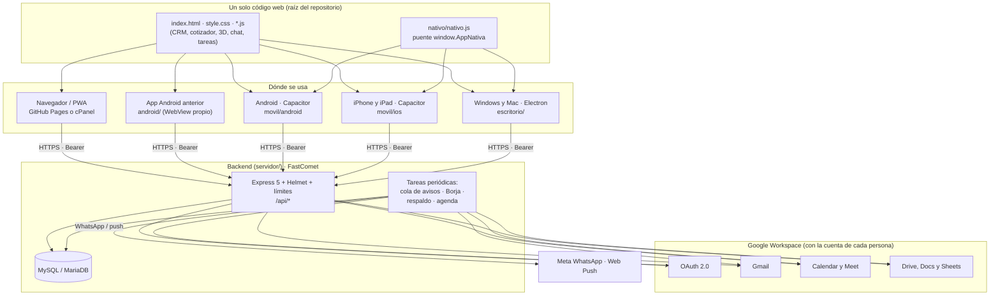

# Semences del Caribe · Sistema completo (web, móvil, escritorio y backend)

> **Documento maestro de la arquitectura híbrida** del CRM de Semences del Caribe: una sola app web que funciona en
> el navegador, en **Android, iPhone y iPad** (Capacitor) y en **Windows y Mac** (Electron), con un backend
> **Node.js + MySQL** conectado a **Google Workspace**. Incluye el manual para configurar Google Cloud, todas las
> variables de entorno y cómo se compila y se reparte cada app.
>
> Complementa a `DOCUMENTACION_COMPLETA.md` (arquitectura interna de la web y del backend, modelo de permisos y
> auditoría de noviembre de 2026). Guías de despliegue: `servidor/LEEME.md` (FastComet) y `android/LEEME.md`.

---

## Índice

1. [La arquitectura en una página](#1-la-arquitectura-en-una-página)
2. [Un código web, cinco envoltorios](#2-un-código-web-cinco-envoltorios)
3. [El puente nativo (window.AppNativa)](#3-el-puente-nativo-windowappnativa)
4. [Inicio de sesión con Google en todas las plataformas](#4-inicio-de-sesión-con-google-en-todas-las-plataformas)
5. [Backend: seguridad (bloque 1)](#5-backend-seguridad-bloque-1)
6. [Google Workspace: Drive, Calendar y Gmail (bloque 2)](#6-google-workspace-drive-calendar-y-gmail-bloque-2)
7. [Manual: configurar Google Cloud y Google Workspace](#7-manual-configurar-google-cloud-y-google-workspace)
8. [Variables de entorno](#8-variables-de-entorno)
9. [Apps móviles con Capacitor (bloque 3)](#9-apps-móviles-con-capacitor-bloque-3)
10. [Apps de escritorio con Electron (bloque 4)](#10-apps-de-escritorio-con-electron-bloque-4)
11. [Compilación automática y descargas (GitHub Actions)](#11-compilación-automática-y-descargas-github-actions)
12. [Pasar de la app Android anterior a la nueva](#12-pasar-de-la-app-android-anterior-a-la-nueva)
13. [Pruebas y verificación](#13-pruebas-y-verificación)
14. [Decisiones, límites y próximos pasos](#14-decisiones-límites-y-próximos-pasos)

---

## 1. La arquitectura en una página



| Capa | Tecnología | Carpeta | Se publica en |
|---|---|---|---|
| App web (PWA) | HTML/CSS/JS sin compilar, Three.js r128, jsPDF 4.2.1 (con SRI) | raíz | GitHub Pages (`publicar.yml`) o cPanel |
| Android | Capacitor 8.5.3 (Gradle, JDK 21, SDK 36, mínimo Android 7) | `movil/android` | Releases (APK firmado) |
| iPhone y iPad | Capacitor 8.5.3 (Xcode, Swift Package Manager, iOS 15+) | `movil/ios` | Xcode → TestFlight / App Store (cuenta de Apple) |
| Windows y Mac | Electron 44.9.3 + electron-builder 26.17.0 | `escritorio` | Releases (`.exe`, `.dmg`, `.zip`) |
| Android anterior | WebView propio en Java, sin Gradle (con widget) | `android` | GitHub Pages (`Semences.apk`) |
| Backend | Node 22/24, Express 5, Helmet 8, express-rate-limit 8, mysql2, `@googleapis/*` | `servidor` | FastComet (Passenger) |

---

## 2. Un código web, cinco envoltorios

Todas las plataformas ejecutan **los mismos archivos de la web**. Las apps los llevan dentro (abren sin conexión) y
cambian solo lo que depende del sistema: cómo se entra con Google, cómo se guarda un PDF y el botón "atrás".

| | Navegador / PWA | Android anterior | Android (Capacitor) | iPhone / iPad (Capacitor) | Windows / Mac (Electron) |
|---|---|---|---|---|---|
| Origen (debe estar en `ORIGENES`) | `https://semillasdata.com`, GitHub Pages | `https://appassets.androidplatform.net` | `https://localhost` | `capacitor://localhost` | `app://semences` |
| Librerías | CDN jsDelivr con SRI | dentro del APK | dentro de la app | dentro de la app | dentro de la app |
| Entrar con Google | página de Google y vuelta a la web | Chrome → `semences://sesion` | Custom Tabs → `semences://sesion` | Safari → `semences://sesion` | navegador del sistema → `semences://sesion` |
| Cotización en PDF | descarga del navegador | carpeta Descargas | menú de compartir (WhatsApp, Drive, Archivos…) | menú de compartir / Guardar en Archivos | "Guardar como" (Descargas) |
| Avisos con la app cerrada | Web Push | WhatsApp | WhatsApp | WhatsApp | WhatsApp |
| Sin conexión | service worker + copia local | copia local | copia local | copia local | copia local |
| Widget | — | sí | — | — | — |

`herramientas/preparar-web.mjs` prepara la copia de la web para cada app: cambia las URLs del CDN por `lib/` (las
mismas versiones, byte a byte), quita los `integrity`, añade `nativo.js` antes que los demás scripts (y `android.js`
en Capacitor), escribe la dirección del backend (`SEMENCES_API`) y deja fuera el service worker.

---

## 3. El puente nativo (window.AppNativa)

`googleSync.js` deja `window.AppNativa = window.AppNativa || window.AndroidApp || null`. Así la app web habla igual
con la app Android anterior (objeto Java `AndroidApp`) que con Capacitor y Electron (`nativo/nativo.js`):

| Función | Qué hace | Capacitor | Electron |
|---|---|---|---|
| `plataforma` | `android`, `ios` o `escritorio` | `Capacitor.getPlatform()` | `'escritorio'` |
| `abrirExterno(url)` | Abre el inicio de sesión de Google fuera de la app | plugin Browser | `shell.openExternal` (solo `https:`) |
| `tomarVueltaGoogle()` | `{ codigo, error }` de `semences://sesion`, una sola vez | plugin App (`appUrlOpen`, `getLaunchUrl`) | `open-url` (Mac) / argumentos (Windows) |
| `guardarArchivo(nombre, b64, tipo)` | Guarda la cotización | Filesystem (caché) + Share | diálogo "Guardar como" |
| `actualizarWidget(json)` | Widget de la pantalla de inicio | no hace nada | no hace nada |

`nativo.js` también pone las clases `app-nativa` y `app-<plataforma>` en `<html>` (estilos táctiles en `style.css`)
y, en Android, conecta el botón "atrás" con `window.atrasAndroid()` (cierra diálogos, paneles y menús antes de salir).

---

## 4. Inicio de sesión con Google en todas las plataformas

Google **no permite** entrar desde dentro de un WebView ni de una ventana de Electron ("navegador no seguro"). Por eso
el inicio de sesión siempre pasa por el **navegador del sistema** y vuelve a la app con un enlace propio:

```mermaid
sequenceDiagram
    participant A as App (web, móvil o escritorio)
    participant N as Navegador del sistema
    participant B as Backend
    participant G as Google
    A->>A: verificador aleatorio (se queda en la app) · reto = SHA-256
    A->>N: /api/auth/google/inicio?reto&cuenta=empresa|personal|conectar
    N->>B: inicio
    B->>G: redirección (state firmado; permisos según la cuenta)
    G->>B: /api/auth/google/vuelta?code&state
    B->>B: comprueba la cuenta · código de un solo uso (2 min) atado al reto
    B->>N: web: …#google-codigo=… · apps: semences://sesion?codigo=…
    N->>A: el sistema abre la app con el enlace
    A->>B: /api/auth/canjear { codigo, verificador }
    B-->>A: sesión (Bearer, 30 días)
```

**Tres botones, tres autorizaciones** (`google.js › opcionesAutorizacion`):

| Botón | Para quién | Permisos que pide | Verificación de Google |
|---|---|---|---|
| **Entrar con tu cuenta @empresa** (principal) | cuentas del Workspace | identidad + Gmail (enviar), Calendar, Drive, Docs | no, si la app es Interna o "de confianza" en el Workspace |
| **Entra con tu cuenta personal de Google** (opción B) | Gmail u otras cuentas personales | solo identidad (`openid email profile`) | **nunca** (permisos básicos) |
| **Conectar Gmail, Calendar y Drive** (en Cuenta) | quien entró con la opción B y quiera esas funciones | los de Workspace | sí, para cuentas externas (ver 7.3) |

Toda cuenta nueva —de la empresa o personal— entra en la **sala de espera** hasta que un Master le asigna cargo,
países y casas comerciales; en *Equipo y accesos* las personales aparecen marcadas como "cuenta personal".
`CUENTAS_PERSONALES=no` vuelve a cerrar la entrada a la empresa (`DOMINIO`), los `ADMINS` y la tabla `equipo`.

---

## 5. Backend: seguridad (bloque 1)

| Capa | Qué hay | Dónde |
|---|---|---|
| Cabeceras HTTP | **Helmet 8.3**: CSP `default-src 'none'` (es una API JSON), HSTS 1 año, `X-Frame-Options`, `frame-ancestors 'none'`, `no-referrer`, `nosniff`, sin `X-Powered-By`, `Cache-Control: no-store` | `src/seguridad.js` |
| Límite de peticiones | **express-rate-limit 8.7.1**: 600/min por IP en toda la API · 20/min por IP en la entrada · 240/min **por sesión** en las acciones (una oficina comparte IP). Cabeceras `RateLimit` estándar y respuesta `429 { codigo: 'limite' }` | `src/seguridad.js` |
| Entrada de datos | Cuerpo JSON objeto (≤ 10 MB), sin `__proto__`/`constructor`/`prototype` a ninguna profundidad, anidamiento ≤ 32, nombre de acción `[a-zA-Z]{1,40}`; validación propia de cada acción (correos, teléfonos, fechas, tamaños, tipos de archivo) | `src/seguridad.js`, `src/acciones.js` |
| SQL | Todas las consultas con parámetros (`?`); `multipleStatements: false`; módulos validados contra una lista. Probado con textos `'); DROP TABLE …` | `src/db.js` |
| Configuración | Esquema de todas las variables (`validarEntorno`): lo peligroso impide arrancar; lo mal escrito se avisa | `src/config.js`, `.env.example` |
| Sesiones y tokens | Huellas SHA-256 en la base; tokens de Google con AES-256-GCM atados a su dueño; PKCE en las apps | `src/cuentas.js`, `src/cifrado.js` |

> **Sobre DDoS:** el límite de peticiones frena abusos y fuerza bruta contra la app, pero un ataque de volumen satura
> la red antes de llegar a Node. Para eso hace falta la protección del hosting o un proxy como **Cloudflare** delante de
> `api.semillasdata.com`. El límite está en memoria: con varios procesos de Passenger, cada uno cuenta por separado.

---

## 6. Google Workspace: Drive, Calendar y Gmail (bloque 2)

El backend usa las **librerías oficiales de Google** en su forma modular (`@googleapis/gmail`, `calendar`, `drive`,
`docs`, `sheets` y `google-auth-library`): son el mismo proyecto `googleapis`, separado por servicio, para no instalar
los ~100 MB del paquete completo en el hosting compartido. Todo lo de Google pasa por `src/google.js` (en las pruebas
se cambia por uno simulado) y por `conGoogle()` (reintentos y reconexión, `src/llamadasGoogle.js`).

| Función | Cómo | Con qué cuenta | Cuándo |
|---|---|---|---|
| **Documentos del cliente** (Drive) | Certificados fitosanitarios, permisos de importación, análisis de germinación, facturas, fotos → carpeta del cliente en `DOCUMENTOS_CARPETA_ID` (PDF, imagen, Word, Excel, CSV; 8 MB) | la de quien sube | botón *Documentos en Drive* del expediente (`subirDocumento`, `documentos`) |
| **Reportes PDF** (Docs + Drive) | Plantilla con `{{campos}}` → PDF en la carpeta del cliente | la de quien lo pide | botón *Reporte PDF en Drive* (`reporte`) |
| **Respaldo del CRM** (Drive) | Todo el CRM en un JSON (`semences-crm-respaldo-AAAA-MM-DD-HHMM.json`) en `RESPALDO_CARPETA_ID`; borra los de más de `RESPALDO_CONSERVAR` días | la del sistema | cada día a `RESPALDO_HORA`; un Master, a mano (`respaldar`) |
| **Exportar a Sheets** | Una pestaña por módulo, la misma hoja cada vez | la de quien exporta | menú › *Exportar el CRM* (`exportar`) |
| **Agenda del CRM** (Calendar) | Seguimientos de clientes (míos o sin asignar), mis tareas y los trasplantes del germinador, de hoy a 60 días, como eventos de día completo que no marcan "ocupado". Cada evento lleva su clave privada: **sincronizar otra vez actualiza o borra, nunca duplica** | la de cada persona | cada mañana a las 6:00 (`AGENDA_AUTOMATICA`); a mano en *Cuenta* (`sincronizarAgenda`) |
| **Reuniones** (Calendar + Meet) | Evento con Meet e invitación al cliente; aviso de horario ocupado | la de quien agenda | expediente del cliente, tablero |
| **Correos** (Gmail) | Cotizaciones con el PDF adjunto | la de quien envía | cotizador (`correo`) |
| **Correos de aviso** (Gmail) | Solicitud de acceso (a los Master), acceso aprobado (a la persona), germinación baja (al equipo técnico del lote). Uno por destinatario, en segundo plano | la del sistema | automático (`CORREOS_AVISOS`) |
| **Resumen de Borja** | Incluye la agenda de Calendar del día | la de cada persona | cada mañana a `RESUMEN_HORA` |

La **cuenta del sistema** (`CUENTA_GOOGLE_SISTEMA`) es una persona del equipo —mejor un Master— que entró en la app
con Google conectado. No hace falta cuenta de servicio ni delegación de dominio, y funciona igual con cuentas
personales. Si esa persona retira el permiso, los respaldos y los correos de aviso se paran (el registro del
servidor lo dice) hasta que vuelva a conectar Google.

---

## 7. Manual: configurar Google Cloud y Google Workspace

> Lo hace **una vez** un administrador del Workspace de la empresa, en <https://console.cloud.google.com>.

### 7.1 Proyecto y APIs

1. Selector de proyectos › **Proyecto nuevo** › nombre `Semences CRM` › Crear.
2. **APIs y servicios › Biblioteca** y activar, una a una: **Gmail API**, **Google Calendar API**, **Google Drive API**,
   **Google Docs API** y **Google Sheets API**.

### 7.2 Pantalla de consentimiento (Google Auth Platform)

Menú › **Google Auth Platform** (antes "Pantalla de consentimiento de OAuth"):

1. **Branding**: nombre `Semences del Caribe`, correo de asistencia, logotipo (`iconos/icono-512.png`), página
   principal (`https://semillasdata.com`), **dominios autorizados**: `semillasdata.com`, y correo de contacto.
2. **Audience** (público):
   - Solo cuentas de la empresa → **Interno**. Sin verificación, sin límites. Pon `CUENTAS_PERSONALES=no`.
   - Empresa **y** cuentas personales (opción B, lo pedido) → **Externo** y estado de publicación **En producción**.
     Las cuentas personales entran solo con su identidad, que **no necesita verificación** (Google no muestra avisos
     ni aplica límites a `openid`, `email` y `profile`).
3. **Data access** (acceso a datos) › *Add or remove scopes*: añade los permisos que usa el backend
   (`servidor/src/google.js › PERMISOS`):

   | Permiso | Para qué | Categoría de Google |
   |---|---|---|
   | `openid`, `email`, `profile` | Identidad | básica |
   | `gmail.send` | Enviar cotizaciones y avisos (no puede leer el correo) | sensible |
   | `calendar.events` | Eventos, reuniones de Meet y agenda del CRM | sensible |
   | `calendar.freebusy` | Saber si una hora está ocupada (sin ver qué hay) | sensible |
   | `documents` | Rellenar la plantilla del reporte | sensible |
   | `drive` | Plantilla, PDF, documentos, respaldos y hoja de exportación | **restringido** |

### 7.3 Que las cuentas de la empresa no vean avisos con la app Externa

Con la app **Externa** y sin verificar, Google muestra "Google no ha verificado esta app" al pedir permisos sensibles o
restringidos y limita a **100 personas** el total de usuarios. Para las cuentas de la empresa se evita así:

1. <https://admin.google.com> › **Seguridad › Acceso y control de datos › Controles de API** › *Administrar acceso de
   apps de terceros* › **Configurar app nueva** › busca el **ID de cliente** (7.4) › ámbito: toda la organización ›
   **De confianza**.
2. Desde ese momento, las cuentas del Workspace dan todos los permisos sin avisos y sin contar para el límite.

Las **cuentas personales** que pulsen *Conectar Gmail, Calendar y Drive* sí verán el aviso (y cuentan para el límite de
100) hasta que la app pase la **verificación de Google** (Google Auth Platform › *Verification center*: verificación de
marca, vídeo de demostración y, por el permiso `drive`, una evaluación de seguridad anual). Si no hace falta que el
personal externo use esas funciones, no hay que verificar nada: entran y trabajan con su identidad.

### 7.4 Credenciales

1. **Google Auth Platform › Clients › Create client** › tipo **Aplicación web** › nombre `Backend Semences`.
2. **URI de redirección autorizados**: `https://api.semillasdata.com/api/auth/google/vuelta` (la `URL_PUBLICA` del
   backend + `/api/auth/google/vuelta`). No hacen falta orígenes de JavaScript.
3. Copia el **ID de cliente** y el **secreto** en `GOOGLE_CLIENT_ID` y `GOOGLE_CLIENT_SECRET` (cPanel, nunca en el
   repositorio).

> **No hace falta** un cliente OAuth para Android, iOS ni escritorio: todas las apps entran a través del backend (el
> cliente "Aplicación web") y vuelven con `semences://sesion`, protegido con PKCE.

### 7.5 Carpetas de Drive

1. En Google Drive, crea una **unidad compartida** `CRM Semences` con tres carpetas: `Reportes y documentos de
   clientes`, `Respaldos del CRM` y la plantilla del reporte (Google Docs con `{{cliente}}`, `{{procesos}}`…).
2. Comparte la unidad con el equipo como **Gestor de contenido**; la carpeta `Respaldos del CRM`, **solo con los
   Master** (cada respaldo lleva todos los clientes y sus teléfonos).
3. Copia los ids (lo que va tras `/folders/` o `/d/` en la dirección) a `REPORTE_CARPETA_ID`,
   `DOCUMENTOS_CARPETA_ID` (o déjala vacía para usar la de reportes), `RESPALDO_CARPETA_ID` y `REPORTE_PLANTILLA_ID`.

### 7.6 Cuenta del sistema

1. Un Master entra en la app con su cuenta de Google (botón principal, con todos los permisos).
2. Su correo va en `CUENTA_GOOGLE_SISTEMA`. Reinicia la app Node en cPanel.
3. Comprueba en `https://api.semillasdata.com/api/salud` que `integraciones` dice `respaldos: true` y `correos: true`.

### 7.7 Orígenes de las apps

`ORIGENES` vacía ya incluye la web, GitHub Pages y las cuatro apps. Si la personalizas, mantén:
`https://appassets.androidplatform.net,https://localhost,capacitor://localhost,app://semences`.

---

## 8. Variables de entorno

Todas están documentadas, con su formato, en **`servidor/.env.example`**; al arrancar se comprueban con
`validarEntorno()` (`src/config.js`). Resumen:

| Grupo | Variables | Obligatoria | Por defecto |
|---|---|---|---|
| Servidor | `URL_PUBLICA` · `ORIGENES` · `URL_APP` | `URL_PUBLICA` (https) | orígenes de la web y de las 4 apps · primer origen |
| Base de datos | `MYSQL_HOST` · `MYSQL_PUERTO` · `MYSQL_USUARIO` · `MYSQL_CLAVE` · `MYSQL_BASE` | usuario y base | `localhost` · `3306` |
| Google: entrada | `GOOGLE_CLIENT_ID` · `GOOGLE_CLIENT_SECRET` · `DOMINIO` · `ADMINS` · `CUENTAS_PERSONALES` | id, secreto y `DOMINIO` o `ADMINS` | cuentas personales: `si` |
| Seguridad | `CLAVE_CIFRADO` · `DIAS_SESION` · `ENTRADAS_POR_MINUTO` · `PETICIONES_POR_MINUTO` · `ACCIONES_POR_MINUTO` | `CLAVE_CIFRADO` (`npm run clave`) | 30 · 20 · 600 · 240 |
| Zona y agenda | `ZONA_HORARIA` · `MINUTOS_REUNION` · `RESUMEN_HORA` · `UMBRAL_GERMINACION` | — | `America/Santo_Domingo` · 30 · 7 · 85 |
| Workspace automático | `CUENTA_GOOGLE_SISTEMA` · `RESPALDO_CARPETA_ID` · `RESPALDO_HORA` · `RESPALDO_CONSERVAR` · `DOCUMENTOS_CARPETA_ID` · `CORREOS_AVISOS` · `AGENDA_AUTOMATICA` | — | — · — · 2 · 30 · la de reportes · `si` · `si` |
| Reportes | `REPORTE_PLANTILLA_ID` · `REPORTE_CARPETA_ID` | — | — |
| Google Chat | `CHAT_WEBHOOK` · `CHAT_TARJETAS` | — | — · `si` |
| Push | `VAPID_PUBLICA` · `VAPID_PRIVADA` · `VAPID_CONTACTO` | — (van juntas: `npm run vapid`) | — |
| WhatsApp | `WHATSAPP_TOKEN` · `WHATSAPP_TELEFONO_ID` · `WHATSAPP_PLANTILLA` · `WHATSAPP_IDIOMA` · `WHATSAPP_VERSION` · `WHATSAPP_PLANTILLA_CLIENTES` · `WHATSAPP_PLANTILLA_RESUMEN` | — (las tres primeras van juntas) | `es` · `v21.0` |

**Secretos de GitHub** (Settings › Secrets and variables › Actions): `SEMENCES_FIRMA` (keystore en base64),
`SEMENCES_CLAVE` (su contraseña) y `SEMENCES_API` (dirección del backend, que se escribe en las apps). Para firmar
las apps de Mac y Windows en el futuro: `CSC_LINK`/`CSC_KEY_PASSWORD` (certificado) y, para notarizar en Mac,
`APPLE_ID`, `APPLE_APP_SPECIFIC_PASSWORD` y `APPLE_TEAM_ID` (variables que lee electron-builder).

---

## 9. Apps móviles con Capacitor (bloque 3)

**Estructura:** `package.json` y `capacitor.config.json` en la raíz (Capacitor 8.5.3 y los plugins App, Browser,
Filesystem y Share); los proyectos nativos en `movil/android` y `movil/ios` (rutas fijadas en la configuración para
no chocar con `android/`, la app anterior). `www/` se genera y no va al repositorio.

**Configuración nativa:**

| | Android (`movil/android`) | iPhone y iPad (`movil/ios`) |
|---|---|---|
| Id | `com.semencesdelcaribe.crm` (el mismo de la app anterior) | `com.semencesdelcaribe.crm` |
| Versión | 2.0.0 · `versionCode` 200 + número de compilación | 2.0.0 (200) |
| Mínimo | Android 7 (API 24) · compila con API 36 | iOS 15 · iPhone **y** iPad (`TARGETED_DEVICE_FAMILY 1,2`) |
| Red | `INTERNET`, `ACCESS_NETWORK_STATE`; sin tráfico sin cifrar | solo HTTPS (ATS por defecto); exenta de la declaración de cifrado |
| Almacenamiento | `READ/WRITE_EXTERNAL_STORAGE` solo hasta Android 9 (desde el 10 no hace falta permiso) | el menú de compartir guarda en Archivos sin permisos |
| Vuelta de Google | `intent-filter` `semences://sesion`, `launchMode singleTask` | `CFBundleURLTypes` → `semences` |
| Pantalla | iconos adaptables y pantalla de inicio de la marca | icono 1024, pantalla de inicio 2732, todas las orientaciones en iPad, multitarea (Split View) |
| Firma | la misma clave que la app anterior (secretos de GitHub) | equipo de Apple Developer en Xcode |

**Táctil:** botones de al menos 44 px en teléfonos y tabletas, sin menú del sistema al mantener pulsado, márgenes
seguros de la muesca, `touch-action: manipulation` (sin retraso del doble toque) y la vista de tarjetas del CRM en
pantallas estrechas.

**Compilar en un ordenador:**

```bash
npm ci
npm run movil:sync                 # prepara www/ y la copia a los dos proyectos
SEMENCES_API=https://api.semillasdata.com npm run movil:sync   # con el backend
npm run android:apk                # APK (necesita Android Studio o el SDK y JDK 21)
npm run ios:abrir                  # abre Xcode (solo en Mac)
```

**iPhone y iPad para producción** (en un Mac con Xcode 26 o posterior):

1. Cuenta de **Apple Developer Program** (99 USD al año) de la empresa.
2. `npm run ios:abrir` › proyecto *App* › *Signing & Capabilities* › **Team** de la empresa (firma automática).
3. En <https://appstoreconnect.apple.com>, crea la app con el id `com.semencesdelcaribe.crm`.
4. Xcode › *Product › Archive* › *Distribute App*: **TestFlight** para probar con el equipo, **App Store** (pública o
   no listada) o **Apple Business Manager** (app personalizada, solo para la empresa).

El proyecto ya compila: GitHub Actions lo compila en cada cambio para el Simulador (iPhone y iPad) sin firmar.

---

## 10. Apps de escritorio con Electron (bloque 4)

`escritorio/` tiene su propio `package.json` (Electron 44.9.3 y electron-builder 26.17.0, versiones fijas).

| Pieza | Qué hace |
|---|---|
| `main.cjs` | Ventana; protocolo `app://semences` (sirve `web/` sin salir de ella); CSP; solo navega dentro de la app; enlaces externos al navegador; permisos del navegador limitados a avisos y portapapeles; una sola copia abierta; registra `semences://` para la vuelta de Google |
| `preload.cjs` | Puente mínimo con aislamiento de contexto y sandbox: `abrirExterno`, `guardarArchivo`, `alRecibirEnlace`, `tomarEnlacePendiente` |
| `recursos/icono.png` | Icono 1024 px (de él salen el `.ico` y el `.icns`) |
| `package.json › build` | Windows: instalador **NSIS x64 en español**, accesos directos, carpeta a elegir. Mac: **dmg y zip** para Intel y Apple Silicon, firma ad-hoc |

```bash
cd escritorio
npm ci
npm start              # probar (prepara web/ y abre la app)
npm run dist:win       # instalador de Windows (en Linux necesita Wine)
npm run dist:mac       # dmg/zip (en un Mac)
```

**Firma de código (recomendada antes de repartir a mucha gente):**

- **Windows:** sin certificado, SmartScreen avisa ("Más información › Ejecutar de todas formas"). Con un certificado
  de firma de código (o Azure Trusted Signing) y `CSC_LINK`/`CSC_KEY_PASSWORD`, el aviso desaparece.
- **Mac:** hoy va con firma **ad-hoc** (abre en Apple Silicon; la primera vez, clic derecho › Abrir). Con un
  certificado *Developer ID Application* (cuenta de Apple Developer) y la notarización, se abre sin avisos: quita
  `"identity": "-"`, pon `hardenedRuntime: true` y las variables `CSC_LINK`, `APPLE_ID`, `APPLE_APP_SPECIFIC_PASSWORD`
  y `APPLE_TEAM_ID`.

---

## 11. Compilación automática y descargas (GitHub Actions)

| Flujo | Cuándo | Qué hace |
|---|---|---|
| `publicar.yml` | cada cambio en `main` | pruebas (Node 22 y 24, MySQL 8.4 y MariaDB 10.11, web) → APK anterior → web en GitHub Pages |
| `multiplataforma.yml` | ramas `auditoria/**` y `apps/**`, etiquetas `v*`, o a mano | pruebas → en paralelo: **Android** (APK firmado y comprobado), **iOS** (Simulador), **Windows** (`.exe`), **Mac** (`.dmg`/`.zip` con firma ad-hoc comprobada) → **versión de prueba en Releases** con todos los archivos |

La firma del APK nuevo **se compara con la del APK publicado**: si no coincidiera, la app no se instalaría encima y el
flujo se detiene sin publicar nada.

**Descargas:** <https://github.com/zandynicasiop-debug/semences-crm/releases> (cada compilación crea una versión de
prueba `v2.0.0-beta.N` con enlaces directos a cada archivo). La primera completa es
[`v2.0.0-beta.4`](https://github.com/zandynicasiop-debug/semences-crm/releases/tag/v2.0.0-beta.4):

| Plataforma | Descarga directa | Tamaño |
|---|---|---|
| Android | [Semences-2.0.0-Android.apk](https://github.com/zandynicasiop-debug/semences-crm/releases/download/v2.0.0-beta.4/Semences-2.0.0-Android.apk) | 4,6 MB |
| Windows (x64) | [Semences-2.0.0-Windows-x64.exe](https://github.com/zandynicasiop-debug/semences-crm/releases/download/v2.0.0-beta.4/Semences-2.0.0-Windows-x64.exe) | 116 MB |
| Mac (Apple Silicon) | [Semences-2.0.0-Mac-arm64.dmg](https://github.com/zandynicasiop-debug/semences-crm/releases/download/v2.0.0-beta.4/Semences-2.0.0-Mac-arm64.dmg) | 126 MB |
| Mac (Intel) | [Semences-2.0.0-Mac-x64.dmg](https://github.com/zandynicasiop-debug/semences-crm/releases/download/v2.0.0-beta.4/Semences-2.0.0-Mac-x64.dmg) | 132 MB |
| iPhone/iPad (Simulador de Xcode) | [Semences-2.0.0-iOS-Simulador.zip](https://github.com/zandynicasiop-debug/semences-crm/releases/download/v2.0.0-beta.4/Semences-2.0.0-iOS-Simulador.zip) | 3,4 MB |

Los cambios que solo tocan documentación (`.md`) no vuelven a compilar las apps.

---

## 12. Pasar de la app Android anterior a la nueva

- **Se instala encima** (mismo id, misma firma, versión mayor): no hace falta desinstalar.
- **Los datos guardados en el teléfono no pasan** (la app nueva usa otro origen, `https://localhost`): antes de
  actualizar, abre la app anterior **con conexión** y espera a que diga *sincronizado*. Después, en la nueva, se entra
  otra vez con Google y todo baja del servidor.
- **Widget:** la app nueva todavía no lo tiene (ver 14).
- Las dos apps pueden convivir mientras el equipo prueba: la anterior sigue publicándose desde `main`.

---

## 13. Pruebas y verificación

| Grupo | Archivo | Pruebas |
|---|---|---|
| Backend completo contra MySQL/MariaDB | `servidor/pruebas/api.test.js` | 36 por base |
| Unidades del backend | `servidor/pruebas/unidad.test.js` y `modulos.test.js` | 9 + 74 |
| App web | `pruebas-web/web.test.js` | 21 |

Comprobado además durante este trabajo:

- **Navegador (Chromium):** las llamadas CORS de la app siguen funcionando con Helmet; librerías con SRI; un jsPDF
  alterado se bloquea; cotización en PDF con jsPDF 4.2.1.
- **Escritorio (Electron real, pantalla virtual):** carga desde `app://semences`, sin Node en la página, CSP activa
  (bloquea scripts en línea), librerías locales, vuelta de Google por `semences://sesion` (una sola vez), no navega
  fuera de la app, no sirve archivos fuera de `web/`.
- **GitHub Actions:** APK de producción compilado y firmado con la clave de la app anterior; proyecto de iOS compilado
  para el Simulador; instalador de Windows y app de Mac con firma ad-hoc verificada.

---

## 14. Decisiones, límites y próximos pasos

| Tema | Estado | Siguiente paso |
|---|---|---|
| Librería de Google | Modular `@googleapis/*` (oficial) en vez del paquete completo `googleapis` | ninguno: misma API, menos peso |
| Avisos push en las apps | Las apps usan WhatsApp; Web Push solo en navegador/PWA | push nativo con Firebase Cloud Messaging (Android) y APNs (iOS): `@capacitor/push-notifications` |
| Widget en la app nueva | No portado | llevar `WidgetSemences.java` a `movil/android` con un plugin pequeño |
| iOS en un iPhone | Proyecto listo; falta la cuenta de Apple | Apple Developer Program → TestFlight |
| Firma de Windows y Mac | Sin certificado (SmartScreen / Gatekeeper avisan) | certificado de firma de código y notarización |
| Verificación de Google | No necesaria para empresa (de confianza) ni para entrar con cuenta personal | solo si personas externas deben usar Gmail/Drive |
| DDoS | Límites por IP y sesión en la app | Cloudflare (u otra protección de red) delante del backend |
| Avisos de npm en herramientas de compilación | `@capacitor/cli` y `electron-builder` arrastran avisos moderados de `glob`/`minimatch`/`uuid`; **no van dentro de las apps** (`npm audit --omit=dev`: 0) | actualizar cuando Capacitor y electron-builder publiquen versiones con las dependencias nuevas |
| Three.js r128 | Sin vulnerabilidades conocidas | migración a módulos ES como proyecto aparte |
